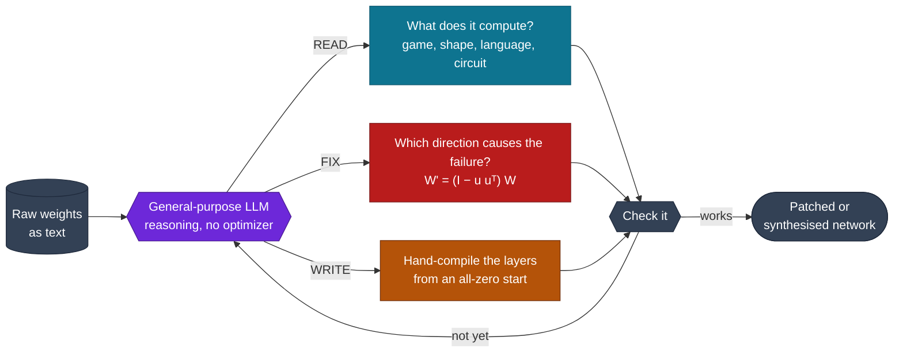
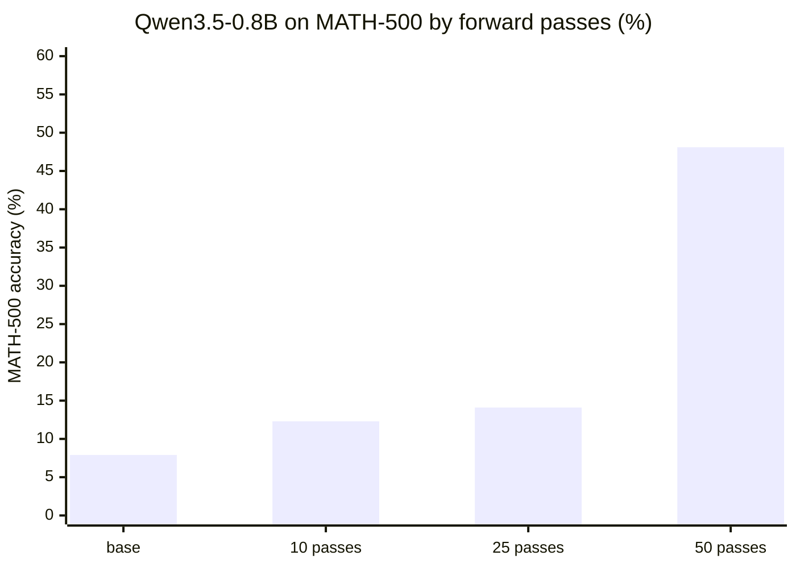
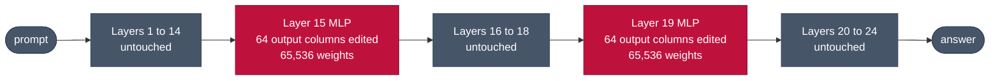
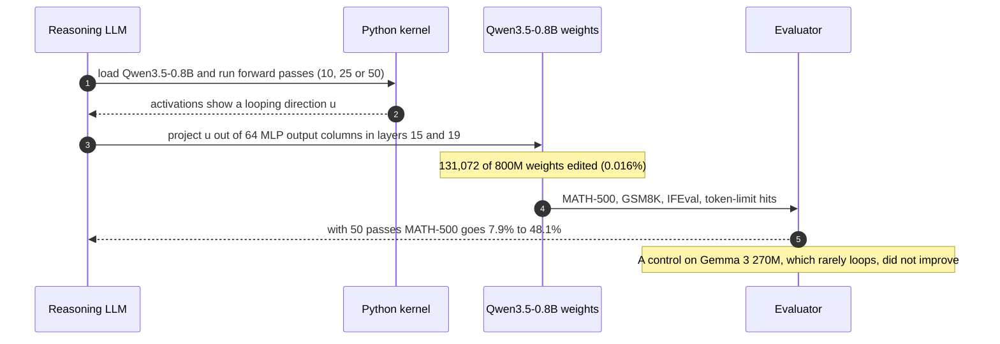
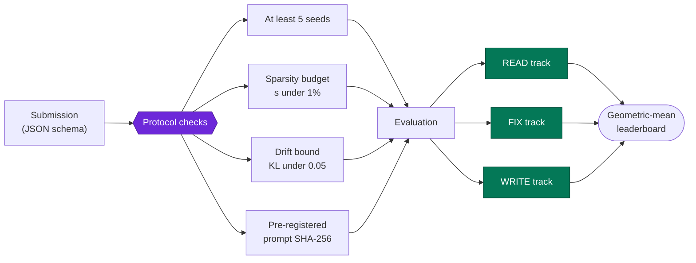
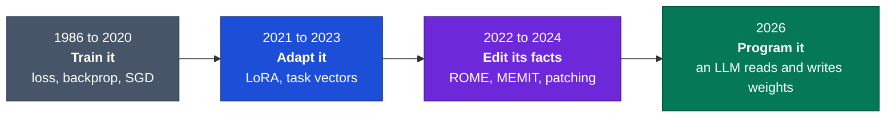
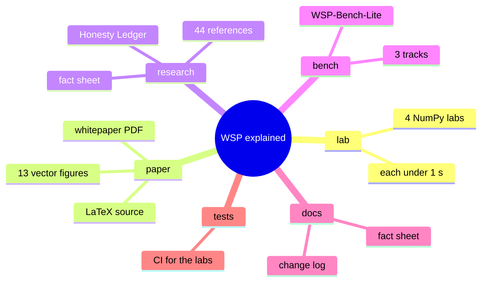

<div align="center">

<a href="https://weight-space-atlas.vercel.app/">
  <picture>
    <source media="(prefers-color-scheme: dark)" srcset="assets/readme/banner-dark.png">
    <source media="(prefers-color-scheme: light)" srcset="assets/readme/banner-light.png">
    
  </picture>
</a>

<a href="https://weight-space-atlas.vercel.app/">
  
</a>

<h1>Weight-Space Programming, Explained</h1>

<p>
  <b>An interactive atlas, four runnable labs, a whitepaper and a public audit of the MIT CSAIL result<br>
  that a language model can read, repair and write another network's weights directly.</b>
</p>

## 📊 **Project Artifacts & GitHub Stats**

<div align="center">

<!-- Table 1: Primary Project Artifacts (for-the-badge style) -->
<table align="center">
    <thead align="center">
        <tr>
            <td><b>🌐 Live Atlas</b></td>
            <td><b>📄 Whitepaper</b></td>
            <td><b>🧪 Labs CI</b></td>
            <td><b>🛡️ Truth Contract</b></td>
            <td><b>🏆 Benchmark</b></td>
        </tr>
    </thead>
    <tbody align="center">
        <tr>
            <td>
                <a href="https://weight-space-atlas.vercel.app/">
                    
                </a>
            </td>
            <td>
                <a href="paper/whitepaper.pdf">
                    
                </a>
            </td>
            <td>
                <a href="https://github.com/Hunterdii/weight-space-programming-explained/actions">
                    
                </a>
            </td>
            <td>
                <a href="docs/fact-sheet.md">
                    
                </a>
            </td>
            <td>
                <a href="bench/WSP-Bench-Lite.md">
                    
                </a>
            </td>
        </tr>
    </tbody>
</table>

<!-- Table 2: Repository Stats & License (flat style) -->
<table align="center">
    <thead align="center">
        <tr>
            <td><b>🌟 Stars</b></td>
            <td><b>🍴 Forks</b></td>
            <td><b>🐛 Issues</b></td>
            <td><b>🕒 Last Commit</b></td>
            <td><b>📜 Content License</b></td>
        </tr>
    </thead>
    <tbody align="center">
        <tr>
            <td>
                <a href="https://github.com/Hunterdii/weight-space-programming-explained/stargazers">
                    
                </a>
            </td>
            <td>
                <a href="https://github.com/Hunterdii/weight-space-programming-explained/forks">
                    
                </a>
            </td>
            <td>
                <a href="https://github.com/Hunterdii/weight-space-programming-explained/issues">
                    
                </a>
            </td>
            <td>
                <a href="https://github.com/Hunterdii/weight-space-programming-explained/commits/main">
                    
                </a>
            </td>
            <td>
                <a href="LICENSE-CONTENT.md">
                    
                </a>
            </td>
        </tr>
    </tbody>
</table>

<h4>
  <a href="https://weight-space-atlas.vercel.app/">Launch Live Atlas</a>
  <span> · </span>
  <a href="#-30-second-quickstart-run-on-any-laptop">30-Second Quickstart</a>
  <span> · </span>
  <a href="#-the-8-headline-breakthrough-experiments">8 Breakthroughs Scoreboard</a>
  <span> · </span>
  <a href="#evidence">What the Evidence Supports</a>
  <span> · </span>
  <a href="paper/whitepaper.pdf">Download Whitepaper</a>
  <span> · </span>
  <a href="#bench">WSP-Bench-Lite</a>
  <span> · </span>
  <a href="#faq">FAQ</a>
  <span> · </span>
  <a href="#cite">Cite</a>
  <span> · </span>
  <a href="#-how-you-can-support">Support & Sponsor</a>
</h4>

<p>
  <small align="justify">
    Curated with epistemic integrity by 
    <a href="https://github.com/Hunterdii"><b>Het Patel (@Hunterdii)</b></a>, MSc Data Science.
  </small>
</p>

</div>

<br>

<picture>
  <source media="(prefers-color-scheme: dark)" srcset="assets/readme/stats-dark.svg">
  <source media="(prefers-color-scheme: light)" srcset="assets/readme/stats-light.svg">
  
</picture>

</div>

<br>

> [!IMPORTANT]
> **Independent companion, not the original research.** Weight-Space Programming (WSP) comes from the MIT CSAIL post [*"Sparks of Weight-Space Programming: LLMs can natively read & write neural network weights"*](https://rikiyat.github.io/blog/weight-space-programming/) by **Rikiya Takehi, Jayden Teoh, Alex Zhang and Omar Khattab** (2 Nov 2026). All scientific credit is theirs. This repository explains it, re-derives the small mechanics in code, and audits how far the evidence goes. It is not affiliated with or endorsed by MIT, MIT CSAIL or the authors.

For forty years we changed neural networks by **training** them: show data, measure error, nudge millions of numbers along a gradient. The MIT CSAIL post reports something stranger. A general-purpose frontier LLM (GPT-6 Astra in the post) was handed another network's raw weights as text, worked out what each part computes, and **edited the numbers directly**. No optimizer, no training loop.

This repo is the part that lets you *check* that claim: **play with it, run it, read the maths, and see exactly where the evidence stops.**

<details>
<summary><b>Table of contents</b></summary>

## 📑 **Table of Contents**

1. 🚀 **[Start here](#-primary-navigation--quick-links)**
2. 💡 **[The idea](#-the-weight-space-paradigm-shift-why-everyone-is-talking-about-wsp)**
3. 🌐 **[The live atlas](#-experience-the-live-interactive-atlas)**
4. ⚡ **[The surgery, in motion](#-architectural-blueprints--system-mechanics)**
5. ⏱️ **[Run it in 30 seconds](#-30-second-quickstart-run-on-any-laptop)**
6. 📊 **[The eight experiments](#-the-8-headline-breakthrough-experiments)**
7. 🧮 **[The maths](#-mathematical-foundations-of-weight-space-surgery)**
8. 🛡️ **[What the evidence supports](#️-the-epistemic-truth-contract--honesty-ledger)**
9. 🏆 **[WSP-Bench-Lite](#-wsp-bench-lite-standardizing-the-frontier)**
10. 🧭 **[Where WSP sits in history](#-the-4-era-evolution-of-model-programming)**
11. 🗺️ **[Repository map](#-interactive-runnable-labs-python-310--numpy-2x)**
12. 🛠️ **[Tech stack](#️-tech-stack--tooling)**
13. ❓ **[FAQ](#-why-this-matters-to-you)**
14. 🤝 **[Contribute](#-how-to-contribute)**
15. 📖 **[Cite](CITATION.cff)**
16. ⚖️ **[Credits, licence, disclaimer](#️-legal--academic-disclaimer)**
</details>

<p align="center">
  <picture>
    <source media="(prefers-color-scheme: dark)" srcset="assets/readme/divider-dark.svg">
    <source media="(prefers-color-scheme: light)" srcset="assets/readme/divider-light.svg">
    
  </picture>
</p>

<a id="start"></a>

## Start here

Pick the row that matches your time and background. Every link goes somewhere that works today.

| You are... | Time | Do this |
|:--|:-:|:--|
| **Curious** (no maths needed) | 2 min | Open the [atlas](https://weight-space-atlas.vercel.app/), drag the surgery slider, then read [Ch 1, *A Network Is a Pile of Numbers*](https://weight-space-atlas.vercel.app/read/1-pile-of-numbers/). |
| **ML engineer** | 10 min | Run [`lab/02_direction_surgery.py`](lab/02_direction_surgery.py), then read [Ch 5, *FIX*](https://weight-space-atlas.vercel.app/read/5-fix/). |
| **Safety or security reader** | 15 min | Read [Ch 11, *The Severe Stuff*](https://weight-space-atlas.vercel.app/read/11-the-severe-stuff/), a risk atlas told responsibly. |
| **Researcher or reviewer** | 1 hour | Read the [whitepaper](paper/whitepaper.pdf), then [What the evidence supports](#evidence) and the [Honesty Ledger](research/open-verification-items.md). |
| **Builder** | a weekend | Pick a [contribution](#contribute): replicate on another model family, or write Lab 5. |

<a id="idea"></a>

## The idea

<picture>
  <source media="(prefers-color-scheme: dark)" srcset="assets/readme/ribbon-dark.svg">
  <source media="(prefers-color-scheme: light)" srcset="assets/readme/ribbon-light.svg">
  
</picture>

Today a network's weights are written by an optimizer. WSP asks what happens if they are written like **source code**: read, understood, patched and compiled by something that can reason.

<picture>
  <source media="(prefers-color-scheme: dark)" srcset="assets/readme/verbs-dark.svg">
  <source media="(prefers-color-scheme: light)" srcset="assets/readme/verbs-light.svg">
  
</picture>

|  | **READ** | **FIX** | **WRITE** |
|:--|:--|:--|:--|
| **Question** | What was this network trained to do? | Why does it fail, and what is the smallest edit that stops it? | Can you write a working network from nothing? |
| **Headline** | Named the right game for all 4 networks from 17,253 raw weights each | Ramp-climbing car: **0 / 256 → 1,024 / 1,024** by editing 3.5% of weights | Breakout from all-zero weights: **517.4** vs **25.3** for PPO at 500M steps |
| **Flagship** | Exp 1 to 3 | **Exp 8**: Qwen3.5-0.8B, **0.016%** of weights, MATH-500 **7.9% → 48.1%** | Exp 5 and 6 |



> [!NOTE]
> **What "no gradient descent" does and does not mean.** Experiments 1 to 3 used no tools and no forward passes. Experiments 6 and 8 gave the LLM a Python sandbox and a budget of forward passes (up to 50 in Exp 8) to look at behaviour. There were never gradients or training loops, but the model was not always working blind. Details in [What the evidence supports](#evidence).

<a id="atlas"></a>

## The live atlas

**[weight-space-atlas.vercel.app](https://weight-space-atlas.vercel.app/)** is a free interactive field guide. No sign-up, WCAG 2.2 AA, light and dark themes.

<a href="https://weight-space-atlas.vercel.app/">
  <picture>
    <source media="(prefers-color-scheme: dark)" srcset="assets/readme/atlas-dark.png">
    <source media="(prefers-color-scheme: light)" srcset="assets/readme/atlas-light.png">
    
  </picture>
</a>

| Feature | What you get |
|:--|:--|
| **3D weight lattice** | A 64×64 matrix of Layer 15's MLP `W_gate`. Hover to read a weight, switch between Read, Fix and Write, drag ΔW. |
| **Rank-1 surgery simulator** | Drag α in `W′ = (I − α·uuᵀ)W` across 64 columns and watch the Exp 8 numbers move. |
| **Fingerprint lab** | The Atari weight fingerprints of Exp 1, recomputed live from the authors' published prompts. |
| **Five reading levels** | Every paragraph reads from *curious observer* up to *frontier researcher*. |
| **Truth Contract** | Press <kbd>T</kbd> and everything that is not a paper-reported fact disappears. |
| **Adaptive pathways** | Curious observer, ML engineer, safety auditor, academic researcher. |
| **Instruments** | A 15-question quiz, 60+ glossary terms, 12 FAQs, 44 references and a scoreboard of all 8 experiments. |

<details>
<summary><b>The 13-chapter curriculum</b></summary>

| Part | # | Chapter | Read |
|:--|:-:|:--|:-:|
| **I · Foundations** | 01 | [A Network Is a Pile of Numbers](https://weight-space-atlas.vercel.app/read/1-pile-of-numbers/) | 9 min |
| | 02 | [How Weights Get Written: Three Old Ways, One New](https://weight-space-atlas.vercel.app/read/2-how-weights-are-written/) | 10 min |
| | 03 | [Cousins of WSP: Who Else Touches the Weights?](https://weight-space-atlas.vercel.app/read/3-cousins/) | 9 min |
| **II · The Experiments** | 04 | [READ: Guessing Games With Real Weight Lists](https://weight-space-atlas.vercel.app/read/4-read/) | 13 min |
| | 05 | [FIX: Surgery on a Ramp and on a Thought Loop](https://weight-space-atlas.vercel.app/read/5-fix/) | 13 min |
| | 06 | [WRITE: Policies Born From Pure Thought](https://weight-space-atlas.vercel.app/read/6-write/) | 11 min |
| | 07 | [How Did It Do It? Two Mechanisms](https://weight-space-atlas.vercel.app/read/7-how-did-it-do-it/) | 9 min |
| **III · Judgement** | 08 | [Measured vs Anecdote: Sorting the Evidence](https://weight-space-atlas.vercel.app/read/8-measured-vs-anecdote/) | 9 min |
| | 09 | [Small Models, Big Models: Who Benefits?](https://weight-space-atlas.vercel.app/read/9-small-vs-big/) | 8 min |
| **IV · Futures & Risks** | 10 | [What Comes Next: Predictions and the Horizon Map](https://weight-space-atlas.vercel.app/read/10-what-comes-next/) | 8 min |
| | 11 | [The Severe Stuff: a Risk Atlas, Told Responsibly](https://weight-space-atlas.vercel.app/read/11-the-severe-stuff/) | 10 min |
| | 12 | [Het's Lab: Three Runnables and a Benchmark Proposal](https://weight-space-atlas.vercel.app/read/12-hets-lab/) | 9 min |
| | 13 | [The Library: Glossary, Quiz, References, Open Items](https://weight-space-atlas.vercel.app/read/13-glossary-quiz-refs/) | 6 min |

Shortcuts: [Prologue](https://weight-space-atlas.vercel.app/prologue/) · [8 experiments](https://weight-space-atlas.vercel.app/experiments/) · [Labs](https://weight-space-atlas.vercel.app/lab/) · [Quiz](https://weight-space-atlas.vercel.app/quiz/) · [Glossary](https://weight-space-atlas.vercel.app/glossary/) · [References](https://weight-space-atlas.vercel.app/references/) · [FAQ](https://weight-space-atlas.vercel.app/faq/) · [Scoreboard and audit](https://weight-space-atlas.vercel.app/about/)

</details>

<a id="surgery"></a>

## The surgery, in motion

The flagship result is **Experiment 8**. Qwen3.5-0.8B, running in thinking mode, kept falling into a reasoning loop: **93.0%** of its answers hit the token limit before finishing. The LLM found the direction behind the loop and projected it out of 64 MLP output columns in each of two layers.

<picture>
  <source media="(prefers-color-scheme: dark)" srcset="assets/readme/surgery-dark.svg">
  <source media="(prefers-color-scheme: light)" srcset="assets/readme/surgery-light.svg">
  
</picture>

🟨 *The animation is a teaching schematic. Only the endpoints in the table below are paper-reported.*

**Qwen3.5-0.8B, by the number of forward passes the LLM was allowed** (🟦 paper-reported):

| | MATH-500 | GSM8K | IFEval | Hit token limit |
|:--|--:|--:|--:|--:|
| Base model | 7.9% | 13.8% | 21.0% | 93.0% |
| Edited, 10 passes | 12.3% | 25.7% | 49.0% | 87.2% |
| Edited, 25 passes | 14.1% | 25.1% | 39.9% | 86.4% |
| Edited, 50 passes | **48.1%** | **67.1%** | **62.3%** | **33.1%** |



The edit touches two layers and nothing else:





<a id="quickstart"></a>

## Run it in 30 seconds

Python 3.10+ and NumPy. **No GPU, no PyTorch, no API keys.**

```bash
git clone https://github.com/Hunterdii/weight-space-programming-explained.git
cd weight-space-programming-explained
pip install -r requirements.txt

python lab/01_compile_a_rule.py       # WRITE: hand-compile a 17-number network that plays paddle
python lab/02_direction_surgery.py    # FIX:   rank-1 surgery, (I − u uᵀ) W
python lab/03_blast_radius.py         # MEASURE: verify the 0.016% arithmetic
python lab/04_fingerprint_games.py    # READ:  recompute the Exp 1 weight fingerprints
```

Real output from a clean run:

```text
$ python lab/01_compile_a_rule.py
all asserts passed - your 17-number brain plays paddle

$ python lab/02_direction_surgery.py
max |u^T W'| = 6.661338147750939e-16
edited 8/64 columns; remaining u-energy 0.74

$ python lab/03_blast_radius.py
0.0164%
131072

$ python lab/04_fingerprint_games.py
breakout  strongest row 8 (58%)   strongest column 8 (17%)
pong      strongest row 2 (14%)   strongest column 1 (55%)
pacman    strongest row 8 (16%)   strongest column 1 (16%)
freeway   strongest row 6 (20%)   strongest column 4 (22%)
```

**Lab 4 is the fun one.** Breakout's agent weights pile into row 8 (58%): the bottom row, where the paddle lives. Pong's pile into column 1 (55%). That is the kind of structure the LLM read in Exp 1.

| Lab | Verb | What it proves | Tier |
|:--|:-:|:--|:-:|
| [`01_compile_a_rule.py`](lab/01_compile_a_rule.py) | WRITE | A rule can be turned into weights with no training | 🟨 schematic |
| [`02_direction_surgery.py`](lab/02_direction_surgery.py) | FIX | `(I − uuᵀ)W` removes a direction exactly (error ≈ 1e-16) | 🟨 schematic |
| [`03_blast_radius.py`](lab/03_blast_radius.py) | MEASURE | 131,072 / 800M ≈ 0.0164% | arithmetic |
| [`04_fingerprint_games.py`](lab/04_fingerprint_games.py) | READ | Atari policies have visible structure in layer 1 | recomputed from released data |

<details>
<summary><b>Lab 1 in 12 lines: a paddle policy with zero training</b></summary>

```python
import numpy as np

# 2-layer ReLU net: input (ball_x, paddle_x) -> move right (+) or left (-)
W1 = np.array([[ 1.0, -1.0],    # fires when the ball is right of the paddle
               [-1.0,  1.0]])   # fires when the ball is left of the paddle
W2 = np.array([[ 1.0, -1.0]])   # action = h0 - h1

def forward(ball, paddle):
    h = np.maximum(0, W1 @ np.array([ball, paddle]))
    return float(W2 @ h)

assert forward(0.8, 0.2) > 0    # ball is right  -> move right
assert forward(0.1, 0.9) < 0    # ball is left   -> move left
assert forward(0.5, 0.5) == 0   # aligned        -> stay
```

No training run produced those numbers. A rule was written down and the weights were derived from it. That is the whole WRITE idea in miniature.

</details>

<a id="experiments"></a>

## The eight experiments

Every number is from the [original post](https://rikiyat.github.io/blog/weight-space-programming/) (🟦 paper-reported); the authors released their logs at [RikiyaT/lm_understand-logs](https://github.com/RikiyaT/lm_understand-logs). **None of these are replications by this repo.**

| # | Verb | Setup | Result |
|:-:|:-:|:--|:--|
| **1** | READ | 4 PPO policies, MLP 500→32→32→5, 17,253 weights each (Breakout, Pong, Pac-Man, Freeway). No tools, options not revealed | Right game for all 4. Breakout named with 99% confidence |
| **2** | READ | 3 diffusion models (circle, square, triangle), 23,824 weights each. No forward pass | Right shape for all 3, found in the output layer (drawn as outlines, not filled) |
| **3** | READ | 3 character transformers (7.16M weights), only the 4 middle blocks, no labels | Right language for all 3 in both attempts. Every copying (induction) head found, none falsely named |
| **4** | FIX | Kinetix car-on-ramp actor, 171,664 weights, stuck in a local minimum | One try, no tools, 3.5% of weights edited: **0 / 256 → 1,024 / 1,024** |
| **5** | WRITE | MinAtar Breakout, Seaquest, Asterix. 600→32→32→6, all weights start at 0, no data, no tools | Beats PPO at 100M steps in all 3 (table below) |
| **6** | WRITE | 9×9 Go, 243→512×6→82 (1,480,274 weights), Python sandbox | With 0 forward passes, wins more than half its games against two small PPO nets. With 50, beats the equal-sized PPO net trained on 20M games |
| **7** | READ | 2 Gemma 3 270M models, one fine-tuned to be sycophantic | From raw weights alone: **failed in all 4 attempts**. Given only attention patterns on its own texts: picked the sycophant in 3 of 3 pairs |
| **8** | FIX | Qwen3.5-0.8B, thinking mode, Python kernel, 10 / 25 / 50 forward passes | 131,072 weights edited (0.016%). With 50 passes: [see above](#surgery) |

**Experiment 5, both sides.** Scores from the post (higher is better):

| Game | PPO 100M steps | PPO 500M steps | LLM, one shot |
|:--|--:|--:|--:|
| Breakout | 15.8 | 25.3 | **517.4** |
| Seaquest | 5.6 | **88.9** | 53.1 |
| Asterix | 25.8 | **55.2** | 53.2 |

The "20×" headline is real, but it is **Breakout only**. Against the stronger PPO baseline the LLM is close in Asterix and reaches about 60% of the score in Seaquest.

<a id="math"></a>

## The maths

<details open>
<summary><b>Rank-1 direction removal (Exp 4 and 8)</b></summary>

Let $u$ be a unit vector for the unwanted direction and $S$ a set of output columns. Then

$$
W' = (I - uu^{\top})\,W \quad \text{on columns } S
\qquad\Longrightarrow\qquad
u^{\top}W'_S = u^{\top}W_S - (u^{\top}u)\,u^{\top}W_S = 0
$$

$(I - uu^{\top})$ is the orthogonal projector onto the complement of $\mathrm{span}(u)$. Everything aligned with $u$ is removed from those columns, and everything orthogonal to $u$ is untouched. [`lab/02_direction_surgery.py`](lab/02_direction_surgery.py) checks this numerically.

</details>

<details open>
<summary><b>Blast radius: why it is 0.016%</b></summary>

Two layers, 64 columns each, hidden size 1,024 (implied by 131,072 / 128 columns):

$$
s=\frac{\lVert\Delta W\rVert_0}{P}=\frac{2\times 64\times 1024}{800{,}000{,}000}=\frac{131{,}072}{800{,}000{,}000}\approx 0.0164\%
$$

Roughly **one weight in 6,100**. [`lab/03_blast_radius.py`](lab/03_blast_radius.py) reproduces it.

</details>

<details>
<summary><b>Reading structure from weights: the Exp 1 fingerprint</b></summary>

The policy's first layer is $W_1 \in \mathbb{R}^{32\times 500}$ over a $10\times 10\times 5$ observation. The sensitivity of cell $(r,c)$ in channel $ch$ is the L2 norm over the 32 hidden units:

$$
\lVert W_1[\,\cdot\,,r,c,ch]\rVert_2=\sqrt{\sum_{k=1}^{32}W_1[k,r,c,ch]^2}
$$

Summing these by row or column gives the fingerprint. In Breakout one row holds 58% of the agent channel's energy.

</details>

<details>
<summary><b>Detecting copying heads (Exp 3)</b></summary>

Following the transformer-circuits formulation, a copying (induction) pair is scored statically from weights:

$$
\mathrm{score}=\frac{\lVert W^{(2)}_{QK}\,W^{(1)}_{OV}\rVert_F}{\lVert W^{(2)}_{QK}\rVert_F\;\lVert W^{(1)}_{OV}\rVert_F}
$$

</details>

<a id="evidence"></a>

## What the evidence supports

WSP is exciting and **very early**; the authors themselves call these results *sparks*. This repo's rule is simple: **every number carries exactly one badge, and the caveats sit next to the headline.**

<picture>
  <source media="(prefers-color-scheme: dark)" srcset="assets/readme/truth-dark.svg">
  <source media="(prefers-color-scheme: light)" srcset="assets/readme/truth-light.svg">
  
</picture>

| Claim people make | What the evidence supports |
|:--|:--|
| "LLMs fixed a model with zero forward passes" | Only Exp 1 to 3 and the 0-pass Go run were that blind. Exp 8's 48.1% used 50 forward passes in a Python harness. With 10 or 25 passes the gain was small. |
| "It made the model better at math" | It removed an obstacle: 93% of answers were hitting the token limit. On **Gemma 3 270M**, which rarely loops, the edits did not help (MATH-500 6.8% to at most 7.7%). The authors say the same: removing an obstacle can reveal an ability, not add one. |
| "LLMs can read any behaviour from weights" | Exp 7 failed from raw weights in 4 of 4 attempts. It only worked once attention patterns were provided. |
| "It beats RL" | True for Breakout against PPO at 500M steps. Not for Seaquest or Asterix. |
| "This is settled" | One lab, a few seeds, one frontier model, published as a research blog post rather than a peer-reviewed paper. |

### Independent reviews 🟩

| Who | When | What they found |
|:--|:--|:--|
| **Prof. Andreas Maier** | 5 Nov 2026 | [A review](https://akmaier.substack.com/p/weight-space-programming-what-is) that separates what was measured from what is anecdote, and flags single-run results. |
| **Matthew Honnibal** | 3 Nov 2026 | Argued the post is misleading because it joins two different questions: can an LLM *read* weights, and can it *edit* them usefully. |
| **Sean Goedecke** | Nov 2026 | Walked through the Qwen fix and showed the steps are the ones a human ML researcher would take. His analogy: editing weights is like patching a compiled binary, a neat trick but not the best way to build software. |
| **Simon Willison** | 3 Nov 2026 | [Re-ran the no-tools reading test](https://simonwillison.net/2026/nov/3/qwen-can-interpret-model-weights) on his laptop with a local Qwen 3.8 27B, which named three of the four games. Reading from weights is not unique to one frontier model. |

Everything unresolved is tracked in public in the **[Honesty Ledger](research/open-verification-items.md)**. Found a wrong number? [Open a correction](https://github.com/Hunterdii/weight-space-programming-explained/issues/new?template=correction.yml). Fixing errors is a feature.

<a id="bench"></a>

## WSP-Bench-Lite

A small open protocol to make WSP claims comparable. It is an **original proposal in this repo** (not from the paper's authors), and **no results exist yet**. Spec: [`bench/WSP-Bench-Lite.md`](bench/WSP-Bench-Lite.md).



| Track | Task | Baselines |
|:--|:--|:--|
| **READ** | Identify network function from weights alone | Random guessing, receptive-field scanners, human experts |
| **FIX** | Repair seeded failures (sign flips, dead units, loops) | Random-direction ablation, PCA pruning, decoding truncation |
| **WRITE** | Hand-compile a controller from a spec, no gradient steps | Evaluated over at least 1,000 episodes |

<a id="context"></a>

## Where WSP sits in history

<details>
<summary><b>Four ways of programming a model (this repo's framing)</b></summary>



Chapters [2](https://weight-space-atlas.vercel.app/read/2-how-weights-are-written/) and [3](https://weight-space-atlas.vercel.app/read/3-cousins/) of the atlas cover how WSP differs from fine-tuning, LoRA, task-vector merging and ROME-style editing. Critics note that rank-1 direction removal resembles directional ablation from the interpretability literature, which is worth keeping in mind when judging what is new.

</details>

<a id="map"></a>

## Repository map



```text
.
├── lab/            4 NumPy labs, each runs in under a second
├── bench/          WSP-Bench-Lite, a community benchmark proposal
├── paper/          whitepaper (PDF, LaTeX source, 13 vector figures)
├── research/       references, machine-readable facts, open verification items
├── docs/           fact sheet and change log
├── tests/          pytest checks for the labs
├── assets/         banners, diagrams, animations
├── .github/        issue templates, code of conduct
├── CONTRIBUTING.md
├── CITATION.cff
├── LICENSE         code: MIT
└── LICENSE-CONTENT.md   prose and visuals: CC BY 4.0
```

<a id="stack"></a>

## Tech stack

| | |
|:--|:--|
| **Labs** | Python 3.10+, NumPy. No other runtime dependency. |
| **Atlas** | Next.js on Vercel, WebGL 3D lattice, KaTeX for maths, light and dark themes. |
| **Paper** | LaTeX, IEEE-style monograph with vector figures. |
| **Diagrams** | Mermaid in this README, rendered natively by GitHub. |
| **CI** | GitHub Actions runs the lab tests. |

<a id="faq"></a>

## FAQ

<details>
<summary><b>Do I need a GPU or an API key?</b></summary>
<br>
No. The four labs are pure NumPy and each runs in under a second on a laptop. The atlas runs in your browser.
</details>

<details>
<summary><b>Is "no gradient descent" the same as "no forward passes"?</b></summary>
<br>
No. The LLM never used gradients or a training loop. But in Exp 8 it could run up to 50 forward passes of the Qwen model in a Python kernel to look at behaviour, and the big gain only appeared at 50. Only Exp 1 to 3 were fully static. See <a href="#evidence">What the evidence supports</a>.
</details>

<details>
<summary><b>So did it teach Qwen to do maths?</b></summary>
<br>
No. It removed a looping failure that was exhausting the token budget. A control on Gemma 3 270M, which rarely loops, did not improve. The authors make the same point.
</details>

<details>
<summary><b>Is this peer reviewed?</b></summary>
<br>
No. The source is a research blog post from MIT CSAIL. Independent reviewers have already responded (see above), and the <a href="research/open-verification-items.md">Honesty Ledger</a> tracks what is still open.
</details>

<details>
<summary><b>How is this different from fine-tuning, LoRA or ROME/MEMIT?</b></summary>
<br>
Those methods compute an update with an optimizer or a dedicated algorithm. In WSP a general-purpose LLM reasons about the weights as text and chooses the edit itself. The edit in Exp 8 is simple linear algebra, which is exactly why it is easy to verify. Chapter 3 of the atlas compares the cousins.
</details>

<details>
<summary><b>Could this be misused?</b></summary>
<br>
Cheap, targeted weight edits could in principle strip guardrails or plant backdoors, and defenders could use the same tools to audit models. <a href="https://weight-space-atlas.vercel.app/read/11-the-severe-stuff/">Chapter 11</a> maps the risks and defences responsibly, without operational detail.
</details>

<details>
<summary><b>Is this affiliated with MIT or the authors?</b></summary>
<br>
No. It is an independent explainer by <a href="https://github.com/Hunterdii">Het Patel</a>. All discovery credit belongs to the MIT CSAIL authors.
</details>

<details>
<summary><b>Can I reuse the visuals or text?</b></summary>
<br>
Yes. Code is MIT. Prose, whitepaper and figures are CC BY 4.0: reuse them with attribution.
</details>

<a id="contribute"></a>

## Contribute

The most useful contributions are the ones that make a claim **easier to falsify**.

1. **Replicate with more seeds** on another model family (Llama, Mistral, Gemma 2, DeepSeek) and send the logs.
2. **Close an item** in the [Honesty Ledger](research/open-verification-items.md), either way.
3. **Write Lab 5**, for example `05_attention_surgeon.py`, or sweep the surgery rank *k* in Lab 2.
4. **Improve the atlas**: accessibility, translations, new modules.
5. **Star the repo** so other people can find it.

Read [`CONTRIBUTING.md`](CONTRIBUTING.md) first. This project follows the [Code of Conduct](.github/CODE_OF_CONDUCT.md). Corrections and ideas: [correction form](https://github.com/Hunterdii/weight-space-programming-explained/issues/new?template=correction.yml) · [feature request](https://github.com/Hunterdii/weight-space-programming-explained/issues/new?template=feature_request.yml).

<p align="center">
  <a href="https://github.com/Hunterdii/weight-space-programming-explained/graphs/contributors">
    
  </a>
</p>

<!-- <a id="cite"></a>

## Cite

```bibtex
@misc{takehi2026weightspace,
  title        = {Sparks of Weight-Space Programming: LLMs can natively read \& write neural network weights},
  author       = {Takehi, Rikiya and Teoh, Jayden and Zhang, Alex and Khattab, Omar},
  year         = {2026},
  month        = nov,
  howpublished = {\url{https://rikiyat.github.io/blog/weight-space-programming/}}
}

@software{patel2026wspexplained,
  title  = {Weight-Space Programming, Explained: an interactive atlas, labs and audit},
  author = {Patel, Het},
  year   = {2026},
  month  = nov,
  url    = {https://github.com/Hunterdii/weight-space-programming-explained}
}
```

GitHub's **Cite this repository** button reads [`CITATION.cff`](CITATION.cff).

<a id="credits"></a> -->

## Credits, licence, disclaimer

- **Discovery:** Rikiya Takehi, Jayden Teoh, Alex Zhang and Omar Khattab (MIT CSAIL). Their logs: [RikiyaT/lm_understand-logs](https://github.com/RikiyaT/lm_understand-logs).
- **Public review and replication:** Andreas Maier, Matthew Honnibal, Sean Goedecke, Simon Willison.
- **Licence:** code, labs and benchmark are [MIT](LICENSE). Text, whitepaper and visuals are [CC BY 4.0](LICENSE-CONTENT.md).
- **Independence:** this repository is not affiliated with, sponsored by or endorsed by MIT, MIT CSAIL, the original authors or any model vendor mentioned. Numbers marked 🟦 are the authors' claims, reported as published.

<br>

<div align="center">

<picture>
  <source media="(prefers-color-scheme: dark)" srcset="assets/readme/divider-dark.svg">
  <source media="(prefers-color-scheme: light)" srcset="assets/readme/divider-light.svg">
  
</picture>

<br>

<!-- <a href="https://weight-space-atlas.vercel.app/">
  
</a> -->

<br>

**If this made weights feel less like a black box, a ⭐ helps other people find it.**

<!-- [](https://github.com/Hunterdii/weight-space-programming-explained) -->

<a href="https://star-history.com/#Hunterdii/weight-space-programming-explained&Date">
  <picture>
    <source media="(prefers-color-scheme: dark)" srcset="https://api.star-history.com/svg?repos=Hunterdii/weight-space-programming-explained&type=Date&theme=dark">
    <source media="(prefers-color-scheme: light)" srcset="https://api.star-history.com/svg?repos=Hunterdii/weight-space-programming-explained&type=Date">
    
  </picture>
</a>

<br>

Built with intellectual honesty by **[Het Patel (@Hunterdii)](https://github.com/Hunterdii)**, Student<br>
[Atlas](https://weight-space-atlas.vercel.app/) · [GitHub](https://github.com/Hunterdii) · [LinkedIn](https://www.linkedin.com/in/patel-hetkumar-sandipbhai-8b110525a/)

</div>