<div align="center">

<a href="https://weight-space-atlas.vercel.app/">
  <picture>
    <source media="(prefers-color-scheme: dark)" srcset="assets/readme/banner-dark.png">
    <source media="(prefers-color-scheme: light)" srcset="assets/readme/banner-light.png">
    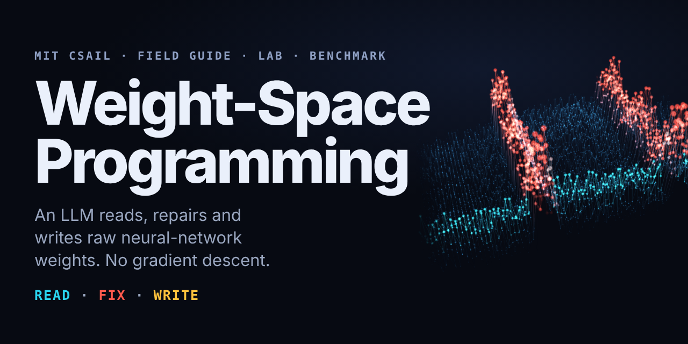
  </picture>
</a>

<a href="https://weight-space-atlas.vercel.app/">
  
</a>

<h1>🏝️ Weight-Space Programming, Explained 🏝️</h1>

<!-- Table 2: Repository Stats & License (flat style) -->

## 🚀 **Project Artifacts & Environment**
<div align="center">

<table aria-label="Primary Quicklinks" width="100%">
  <tr>
    <td width="33%" align="center">
      <a href="https://weight-space-atlas.vercel.app/">
        <br />
        <strong>Live Interactive Atlas</strong>
      </a><br />
      <sub>26 interactive routes · 5 audience levels · Parameter knife</sub>
    </td>
    <td width="33%" align="center">
      <a href="paper/whitepaper.pdf">
        <br />
        <strong>Monograph Whitepaper</strong>
      </a><br />
      <sub>IEEE-typeset monograph · 13 vector figures · Formal proofs</sub>
    </td>
    <td width="33%" align="center">
      <a href="bench/WSP-Bench-Lite.md">
        <br />
        <strong>WSP-Bench-Lite</strong>
      </a><br />
      <sub>Multi-seed protocol (n &ge; 5) · 3 competition tracks</sub>
    </td>
  </tr>
  <tr>
    <td width="33%" align="center">
      <a href="https://github.com/Hunterdii/weight-space-programming-explained/actions">
        <br />
        <strong>4 Zero-Dependency Labs</strong>
      </a><br />
      <sub>Pure Python & NumPy · Runs in &lt;1 second on any laptop</sub>
    </td>
    <td width="33%" align="center">
      <a href="docs/fact-sheet.md">
        <br />
        <strong>Verified Fact Sheet</strong>
      </a><br />
      <sub>Audited numbers · 4-tier epistemic badges · Verified dates</sub>
    </td>
    <td width="33%" align="center">
      <a href="research/open-verification-items.md">
        <br />
        <strong>The Honesty Ledger</strong>
      </a><br />
      <sub>Public tracker of open audit items, caveats & variance flags</sub>
    </td>
  </tr>
</table>

</div>


## ⚙️ **Runtime & Evidence Contracts**

<div align="center">

<table align="center">
    <thead align="center">
        <tr>
            <td><b>⭐ Repository Stars</b></td>
            <td><b>🍴 Forks</b></td>
            <td><b>🐛 Open Issues</b></td>
            <td><b>⏱️ Last Commit</b></td>
            <td><b>🐍 Python Runtime</b></td>
            <td><b>📦 Dependencies</b></td>
            <td><b>🛡️ Truth Contract</b></td>
        </tr>
    </thead>
    <tbody align="center">
        <tr>
            <td>
                <a href="https://github.com/Hunterdii/weight-space-programming-explained/stargazers">
                    
                </a>
            </td>
            <td>
                <a href="https://github.com/Hunterdii/weight-space-programming-explained/forks">
                    
                </a>
            </td>
            <td>
                <a href="https://github.com/Hunterdii/weight-space-programming-explained/issues">
                    
                </a>
            </td>
            <td>
                <a href="https://github.com/Hunterdii/weight-space-programming-explained/commits/main">
                    
                </a>
            </td>
            <td>
                <a href="https://github.com/Hunterdii/weight-space-programming-explained/blob/main/requirements.txt">
                    
                </a>
            </td>
            <td>
                <a href="https://github.com/Hunterdii/weight-space-programming-explained/tree/main/lab">
                    
                </a>
            </td>
            <td>
                <a href="#evidence">
                    
                </a>
            </td>
        </tr>
    </tbody>
</table>

</div>

<h4>
  <a href="https://weight-space-atlas.vercel.app/">Live atlas</a>
  <span>&nbsp;·&nbsp;</span>
  <a href="#quickstart">Run a lab in 30 s</a>
  <span>&nbsp;·&nbsp;</span>
  <a href="#experiments">The 8 experiments</a>
  <span>&nbsp;·&nbsp;</span>
  <a href="#evidence">What the evidence supports</a>
  <span>&nbsp;·&nbsp;</span>
  <a href="paper/whitepaper.pdf">Whitepaper</a>
  <span>&nbsp;·&nbsp;</span>
  <a href="#bench">Benchmark</a>
  <span>&nbsp;·&nbsp;</span>
  <a href="#faq">FAQ</a>
</h4>

<br>

<a href="https://weight-space-atlas.vercel.app/experiments/">
  <picture>
    <source media="(prefers-color-scheme: dark)" srcset="assets/readme/stats-dark.svg">
    <source media="(prefers-color-scheme: light)" srcset="assets/readme/stats-light.svg">
    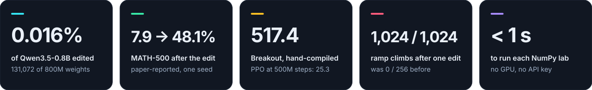
  </picture>
</a>

<br>

<sub>Headline figures are <b>paper-reported</b> and come from single runs. <a href="#evidence">See exactly what they do and do not show.</a></sub>

</div>

> [!IMPORTANT]
> **Independent companion, not the original research.** Weight-Space Programming (WSP) comes from the MIT CSAIL post [*"Sparks of Weight-Space Programming: LLMs can natively read & write neural network weights"*](https://rikiyat.github.io/blog/weight-space-programming/) by **Rikiya Takehi, Jayden Teoh, Alex Zhang and Omar Khattab** (2 Nov 2026). All scientific credit is theirs. This repository explains it, re-derives the small mechanics in code, and audits how far the evidence goes. It is not affiliated with or endorsed by MIT, MIT CSAIL or the authors.
> 
> For forty years we changed neural networks by **training** them: show data, measure error, nudge millions of numbers along a gradient. The MIT CSAIL post reports something stranger. A general-purpose frontier LLM (GPT-6 Astra in the post) was handed another network's raw weights as text, worked out what each part computes, and **edited the numbers directly**. No optimizer, no training loop.
> 
> This repo is the part that lets you *check* that claim: **play with it, run it, read the maths, and see exactly where the evidence stops.**

<br>

<p align="center">
  <a href="https://weight-space-atlas.vercel.app/prologue/">
    <picture>
      <source media="(prefers-color-scheme: dark)" srcset="assets/readme/divider-dark.svg">
      <source media="(prefers-color-scheme: light)" srcset="assets/readme/divider-light.svg">
      
    </picture>
  </a>
</p>

<a id="idea"></a>

<details open>
<summary><h3>🧭 Table of Contents
</h3></summary>

1. [💡 The Idea in 30 Seconds](#-the-idea-in-30-seconds)
2. [🧭 The 4-Era Evolution of Model Programming](#-the-4-era-evolution-of-model-programming)
3. [📐 Architectural Blueprints & System Mechanics](#-architectural-blueprints--system-mechanics)
   - [1. The Tri-Verb Operational Pipeline (`READ · FIX · WRITE`)](#1-the-tri-verb-operational-pipeline-read--fix--write)
   - [2. Flagship Experiment 8: The 0.016% Surgical Attractor Excision](#2-flagship-experiment-8-the-0016-surgical-attractor-excision)
4. [🧭 Choose Your Path](#-choose-your-path)
5. [🌐 The Live Atlas](#-the-live-atlas)
6. [⚡ The Surgery, in Motion](#-the-surgery-in-motion)
7. [⏱️ Run It in 30 Seconds](#️-run-it-in-30-seconds)
8. [📊 The Eight Experiments](#-the-eight-experiments)
9. [🧮 The Maths, Small Enough to Hold in Your Head](#-the-maths-small-enough-to-hold-in-your-head)
    - [1. Rank-1 Direction Removal (Exp 4 and 8)](#1-rank-1-direction-removal-exp-4-and-8)
    - [2. Blast Radius](#2-blast-radius)
10. [🛡️ The Epistemic Truth Contract & Honesty Ledger](#️-the-epistemic-truth-contract--honesty-ledger)
    - [Claim Check](#claim-check)
    - [🟩 Independent Reviews](#-independent-reviews)
    - [Key Methodological Takeaways](#key-methodological-takeaways)
11. [🏆 WSP-Bench-Lite](#-wsp-bench-lite)
12. [🧭 Where WSP Sits in History](#-where-wsp-sits-in-history)
13. [🗺️ Repository Map](#️-repository-map)
14. [❓ FAQ](#-faq)
15. [🤝 Contribute](#-contribute)
16. [📖 Cite](#-cite)
17. [⚖️ Legal & Academic Disclaimer](#️-legal--academic-disclaimer)

</details>


## 💡 The idea in 30 seconds

For forty years we changed neural networks by **training** them: show data, measure error, nudge millions of numbers along a gradient. The weights were an opaque pile.

The MIT CSAIL post reports something stranger. A general-purpose frontier LLM (*GPT-6 Astra* in the post) was handed another network's raw weights **as text**, worked out what each part computes, and **edited the numbers directly**. No optimizer. No training loop.

<div align="center">

<a href="https://weight-space-atlas.vercel.app/read/1-pile-of-numbers/">
  <picture>
    <source media="(prefers-color-scheme: dark)" srcset="assets/readme/verbs-dark.svg">
    <source media="(prefers-color-scheme: light)" srcset="assets/readme/verbs-light.svg">
    
  </picture>
</a>

</div>

|  | **🔍 READ** | **🩺 FIX** | **✍️ WRITE** |
|:--|:--|:--|:--|
| **Question** | What was this network trained to do? | Why does it fail, and what is the smallest edit that stops it? | Can you write a working network from nothing? |
| **Headline** | Named the right game for all 4 networks from 17,253 raw weights each | Ramp-climbing car: **0 / 256 → 1,024 / 1,024** by editing 3.5% of weights | Breakout from all-zero weights: **517.4** vs **25.3** for PPO at 500M steps |
| **Flagship** | Exp 1 to 3 | **Exp 8**: Qwen3.5-0.8B, **0.016%** of weights, MATH-500 **7.9% → 48.1%** | Exp 5 and 6 |
| **Deep dive** | [Ch 4](https://weight-space-atlas.vercel.app/read/4-read/) | [Ch 5](https://weight-space-atlas.vercel.app/read/5-fix/) | [Ch 6](https://weight-space-atlas.vercel.app/read/6-write/) |

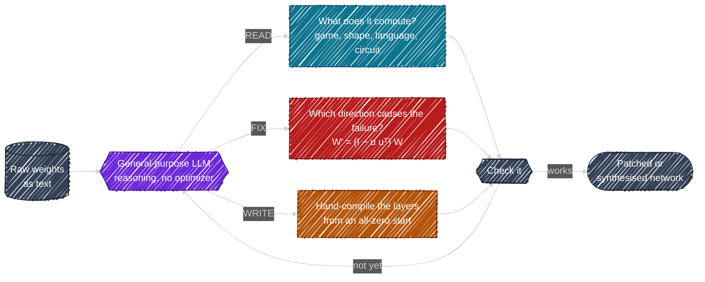

### 🔗 How the Three Verbs Intersect (`READ ∩ FIX ∩ WRITE`)

<div align="center">

<a href="https://weight-space-atlas.vercel.app/read/1-pile-of-numbers/">
  <picture>
    <source media="(prefers-color-scheme: dark)" srcset="assets/readme/venn-dark.svg">
    <source media="(prefers-color-scheme: light)" srcset="assets/readme/venn-light.svg">
    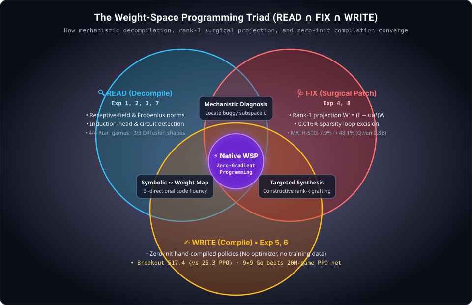
  </picture>
</a>

</div>

> [!NOTE]
> **What "no gradient descent" does and does not mean.** Experiments 1 to 3 used no tools and no forward passes. Experiments 6 and 8 gave the LLM a Python sandbox and a budget of forward passes (up to 50) to look at behaviour. There were never gradients or training loops, but the model was not always working blind. Details in [What the evidence supports](#evidence).

## 🧭 **The 4-Era Evolution of Model Programming**

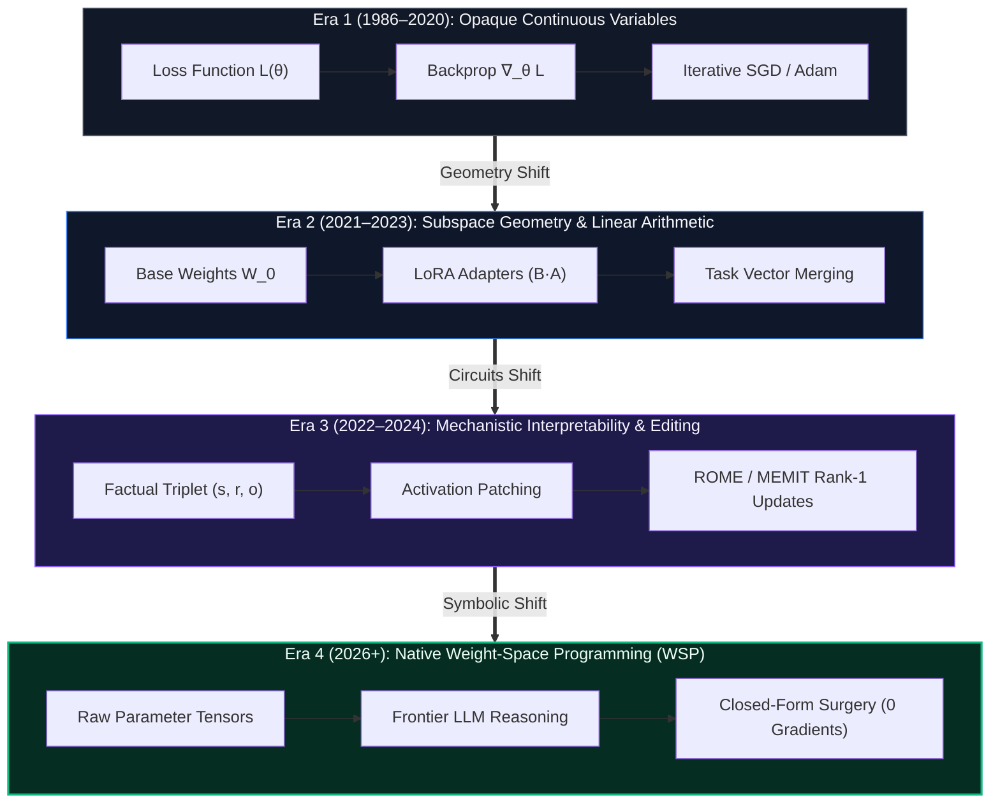

---

## 📐 **Architectural Blueprints & System Mechanics**

<p align="center">
  <a href="https://weight-space-atlas.vercel.app/read/7-how-did-it-do-it/">
    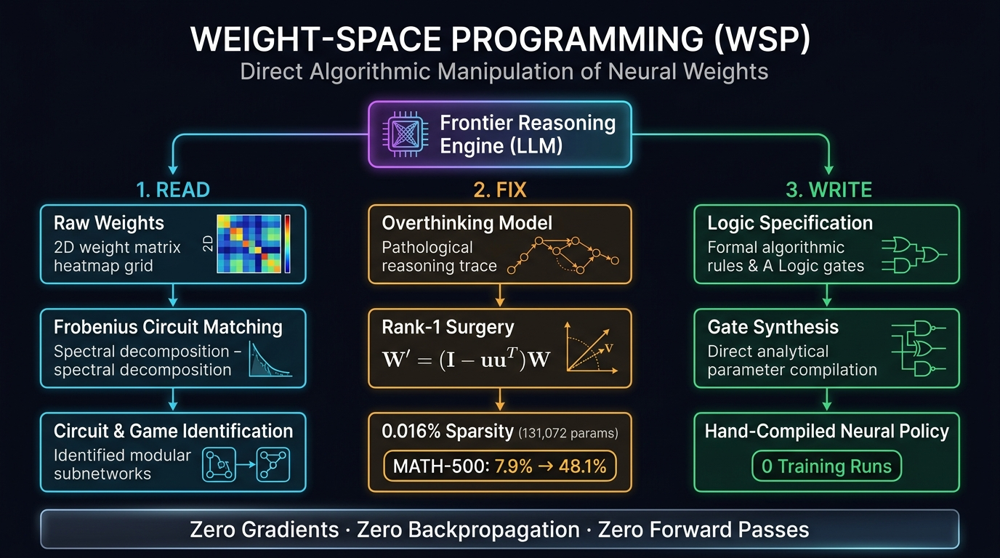
  </a>
</p>

### 1. The Tri-Verb Operational Pipeline (READ · FIX · WRITE)

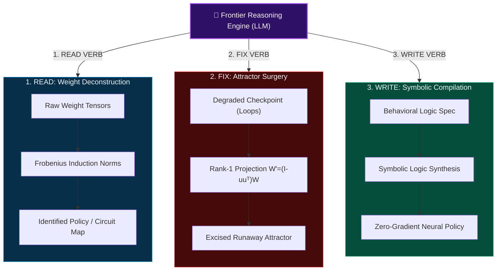

### 2. Flagship Experiment 8: The 0.016% Surgical Attractor Excision

How did modifying only **131,072 parameters** out of **800,000,000** rescue Qwen3.5-0.8B from an infinite overthinking loop?

```mermaid
flowchart LR
    IN["Input Prompt"] --> PRE["Layers 01–14<br>(Untouched)"]

    subgraph SURGERY["Surgical Intervention Zone (0.016% Sparsity Budget)"]
        direction TB
        L15["Layer 15 MLP Block<br>64 Columns Edited (65,536 params)"]
        MID["Layers 16–18<br>(Untouched Residual Stream)"]
        L19["Layer 19 MLP Block<br>64 Columns Edited (65,536 params)"]
        
        L15 --> MID --> L19
    end

    PRE --> L15
    L19 --> POST["Layers 20–24<br>(Untouched)"] --> OUT["Model Output"]

    subgraph RESULTS["Empirical Impact (Qwen3.5-0.8B)"]
        direction TB
        RES1["MATH-500: 7.9% ➔ 48.1% (+40.2%)"]
        RES2["GSM8K: 13.8% ➔ 67.1% (+53.3%)"]
        RES3["Timeouts: 93% ➔ 33% (-60%)"]
        RES4["Total Edited: 131,072 / 800M (0.016%)"]
    end

    OUT -.-> RESULTS

    style SURGERY fill:#18181b,stroke:#ef4444,stroke-width:1px,color:#f4f4f5
    style RESULTS fill:#064e3b,stroke:#10b981,stroke-width:2px,color:#ecfdf5
```


<a id="paths"></a>

### 🧭 Choose your path

| You are... | Time | Do this |
|:--|:-:|:--|
| **Curious** (no maths needed) | 2 min | Open the [atlas](https://weight-space-atlas.vercel.app/), drag the surgery slider, then read [Ch 1, *A Network Is a Pile of Numbers*](https://weight-space-atlas.vercel.app/read/1-pile-of-numbers/). |
| **ML engineer** | 10 min | Run [`lab/02_direction_surgery.py`](lab/02_direction_surgery.py), then read [Ch 5, *FIX*](https://weight-space-atlas.vercel.app/read/5-fix/). |
| **Safety or security reader** | 15 min | Read [Ch 11, *The Severe Stuff*](https://weight-space-atlas.vercel.app/read/11-the-severe-stuff/), a risk atlas told responsibly. |
| **Researcher or reviewer** | 1 hour | Read the [whitepaper](paper/whitepaper.pdf), then [what the evidence supports](#evidence) and the [Honesty Ledger](research/open-verification-items.md). |
| **Builder** | a weekend | Pick a [contribution](#contribute): replicate on another model family, or write Lab 5. |

<br>

<p align="center">
  <a href="https://weight-space-atlas.vercel.app/">
    <picture>
      <source media="(prefers-color-scheme: dark)" srcset="assets/readme/divider-dark.svg">
      <source media="(prefers-color-scheme: light)" srcset="assets/readme/divider-light.svg">
      
    </picture>
  </a>
</p>

<a id="atlas"></a>

## 🌐 The live atlas

**[weight-space-atlas.vercel.app](https://weight-space-atlas.vercel.app/)** is a free interactive field guide to the paper. No sign-up. Light and dark themes.

<div align="center">

<a href="https://weight-space-atlas.vercel.app/">
  <picture>
    <source media="(prefers-color-scheme: dark)" srcset="assets/readme/atlas-dark.png">
    <source media="(prefers-color-scheme: light)" srcset="assets/readme/atlas-light.png">
    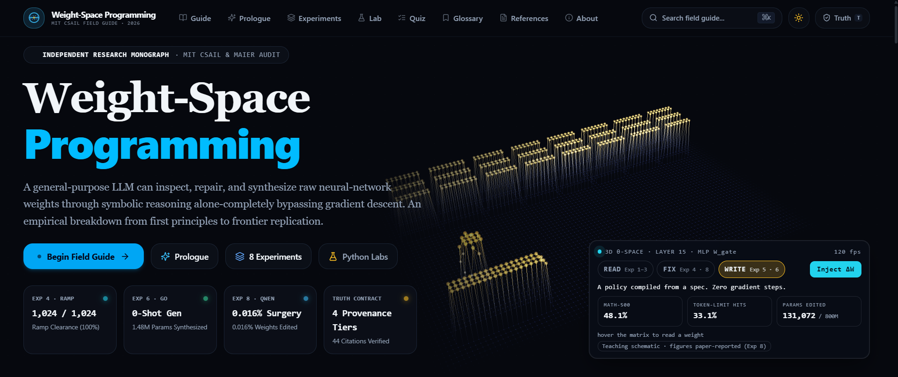
  </picture>
</a>

<sub>The landing page. <a href="https://weight-space-atlas.vercel.app/">Open it live</a> and hover the lattice to read a weight.</sub>

</div>

| Feature | What you get |
|:--|:--|
| **3D weight lattice** | A 64×64 matrix standing in for Layer 15's MLP `W_gate`. Hover to read a weight, switch between Read, Fix and Write, drag ΔW. |
| **Rank-1 surgery simulator** | Drag α in `W′ = (I − α·uuᵀ)W` and watch the Exp 8 numbers move. |
| **Fingerprint lab** | The Atari weight fingerprints of Exp 1, recomputed live from the authors' published prompts. |
| **Five reading levels** | Every chapter reads from *curious observer* up to *frontier researcher*. |
| **Truth Contract** | Press <kbd>T</kbd> and everything that is not a paper-reported fact disappears. |
| **Adaptive pathways** | Curious observer, ML engineer, safety auditor, academic researcher. |
| **Instruments** | 13 chapters, 15 interactive modules, 8 experiment pages, a 15-question [quiz](https://weight-space-atlas.vercel.app/quiz/), 60+ [glossary](https://weight-space-atlas.vercel.app/glossary/) terms, 12 [FAQs](https://weight-space-atlas.vercel.app/faq/) and 44 [references](https://weight-space-atlas.vercel.app/references/). |

<div align="center">

<a href="https://weight-space-atlas.vercel.app/lab/">
  <picture>
    <source media="(prefers-color-scheme: dark)" srcset="assets/readme/atlas-lattice-dark.png">
    <source media="(prefers-color-scheme: light)" srcset="assets/readme/atlas-lattice-light.png">
    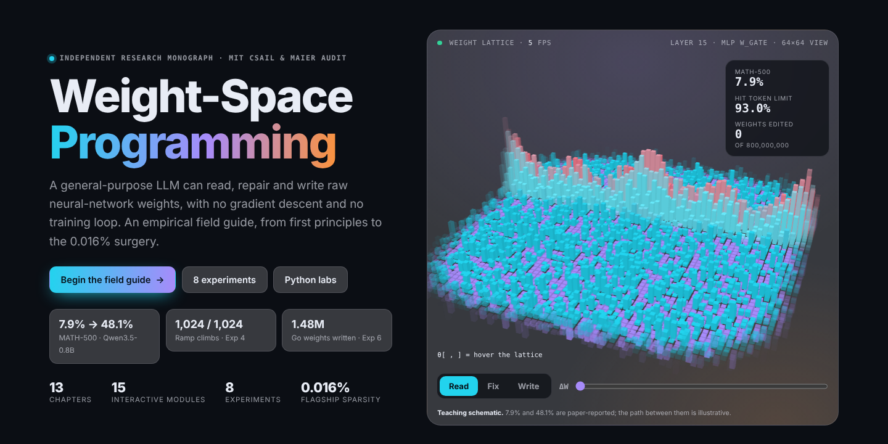
  </picture>
</a>

<sub>Teaching schematic. 7.9% and 48.1% are paper-reported; the path between them is illustrative.</sub>

</div>

<details>
<summary><b>The 13-chapter curriculum</b></summary>
<br>

| Part | # | Chapter | Read |
|:--|:-:|:--|:-:|
| **I · Foundations** | 01 | [A Network Is a Pile of Numbers](https://weight-space-atlas.vercel.app/read/1-pile-of-numbers/) | 9 min |
| | 02 | [How Weights Get Written: Three Old Ways, One New](https://weight-space-atlas.vercel.app/read/2-how-weights-are-written/) | 10 min |
| | 03 | [Cousins of WSP: Who Else Touches the Weights?](https://weight-space-atlas.vercel.app/read/3-cousins/) | 9 min |
| **II · The Experiments** | 04 | [READ: Guessing Games With Real Weight Lists](https://weight-space-atlas.vercel.app/read/4-read/) | 13 min |
| | 05 | [FIX: Surgery on a Ramp and on a Thought Loop](https://weight-space-atlas.vercel.app/read/5-fix/) | 13 min |
| | 06 | [WRITE: Policies Born From Pure Thought](https://weight-space-atlas.vercel.app/read/6-write/) | 11 min |
| | 07 | [How Did It Do It? Two Mechanisms](https://weight-space-atlas.vercel.app/read/7-how-did-it-do-it/) | 9 min |
| **III · Judgement** | 08 | [Measured vs Anecdote: Sorting the Evidence](https://weight-space-atlas.vercel.app/read/8-measured-vs-anecdote/) | 9 min |
| | 09 | [Small Models, Big Models: Who Benefits?](https://weight-space-atlas.vercel.app/read/9-small-vs-big/) | 8 min |
| **IV · Futures & Risks** | 10 | [What Comes Next: Predictions and the Horizon Map](https://weight-space-atlas.vercel.app/read/10-what-comes-next/) | 8 min |
| | 11 | [The Severe Stuff: a Risk Atlas, Told Responsibly](https://weight-space-atlas.vercel.app/read/11-the-severe-stuff/) | 10 min |
| | 12 | [Het's Lab: Three Runnables and a Benchmark Proposal](https://weight-space-atlas.vercel.app/read/12-hets-lab/) | 9 min |
| | 13 | [The Library: Glossary, Quiz, References, Open Items](https://weight-space-atlas.vercel.app/read/13-glossary-quiz-refs/) | 6 min |

Shortcuts: [Prologue](https://weight-space-atlas.vercel.app/prologue/) · [8 experiments](https://weight-space-atlas.vercel.app/experiments/) · [Labs](https://weight-space-atlas.vercel.app/lab/) · [Quiz](https://weight-space-atlas.vercel.app/quiz/) · [Glossary](https://weight-space-atlas.vercel.app/glossary/) · [References](https://weight-space-atlas.vercel.app/references/) · [FAQ](https://weight-space-atlas.vercel.app/faq/) · [Scoreboard and audit](https://weight-space-atlas.vercel.app/about/)

</details>

<br>

<p align="center">
  <a href="https://weight-space-atlas.vercel.app/read/5-fix/">
    <picture>
      <source media="(prefers-color-scheme: dark)" srcset="assets/readme/divider-dark.svg">
      <source media="(prefers-color-scheme: light)" srcset="assets/readme/divider-light.svg">
      
    </picture>
  </a>
</p>

<a id="surgery"></a>

## ⚡ The surgery, in motion

The flagship result is **Experiment 8**. Qwen3.5-0.8B, running in thinking mode, kept falling into a reasoning loop: **93.0%** of its answers hit the token limit before finishing. The LLM found a direction behind the loop and projected it out of 64 MLP output columns in each of two layers.

<div align="center">

<a href="https://weight-space-atlas.vercel.app/read/5-fix/">
  <picture>
    <source media="(prefers-color-scheme: dark)" srcset="assets/readme/surgery-dark.svg">
    <source media="(prefers-color-scheme: light)" srcset="assets/readme/surgery-light.svg">
    
  </picture>
</a>

<sub>🟨 A teaching schematic, not model data. Only the endpoints in the table below are paper-reported. <a href="https://weight-space-atlas.vercel.app/read/5-fix/">Read Ch 5, FIX →</a></sub>

</div>

**Qwen3.5-0.8B, by the number of forward passes the LLM was allowed** (🟦 paper-reported):

| | MATH-500 | GSM8K | IFEval | Hit token limit |
|:--|--:|--:|--:|--:|
| Base model | 7.9% | 13.8% | 21.0% | 93.0% |
| Edited, 10 passes | 12.3% | 25.7% | 49.0% | 87.2% |
| Edited, 25 passes | 14.1% | 25.1% | 39.9% | 86.4% |
| Edited, 50 passes | **48.1%** | **67.1%** | **62.3%** | **33.1%** |

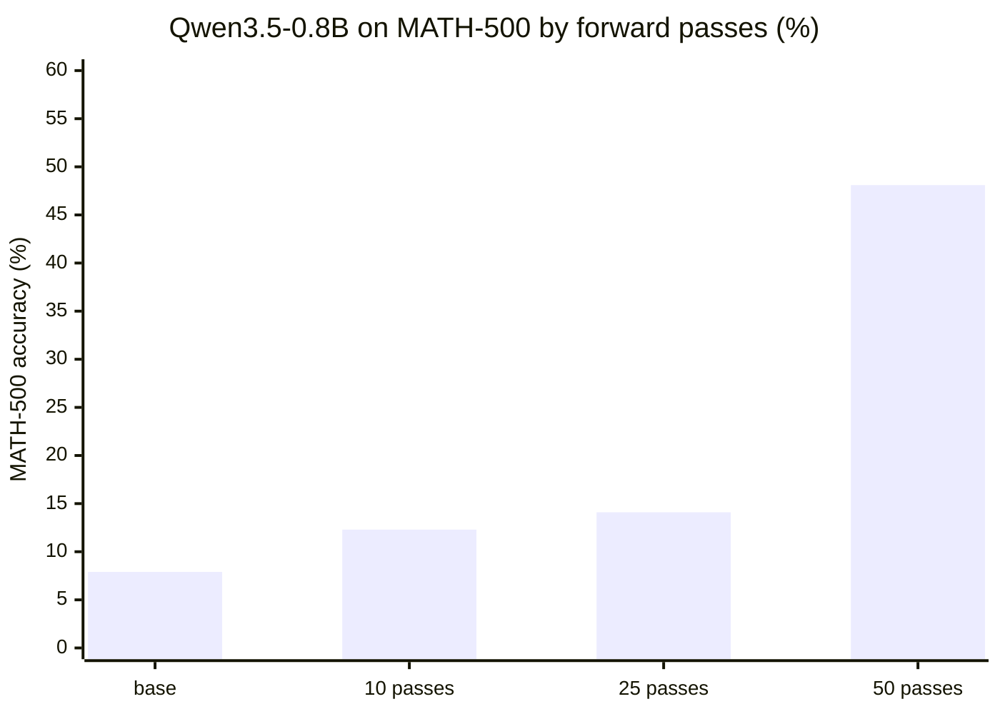

The edit touches two layers (131,072 weights) and leaves 99.984% of the 800M-parameter network completely untouched:

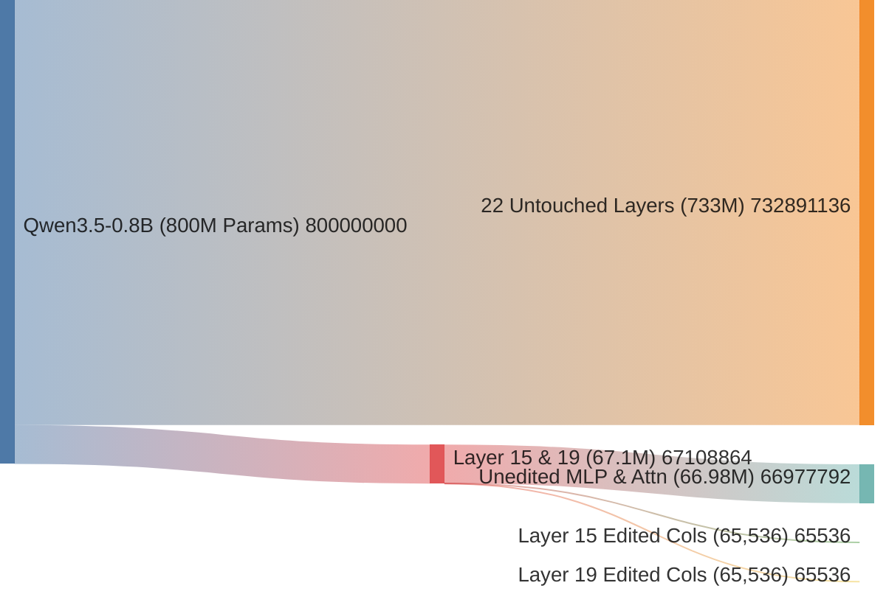

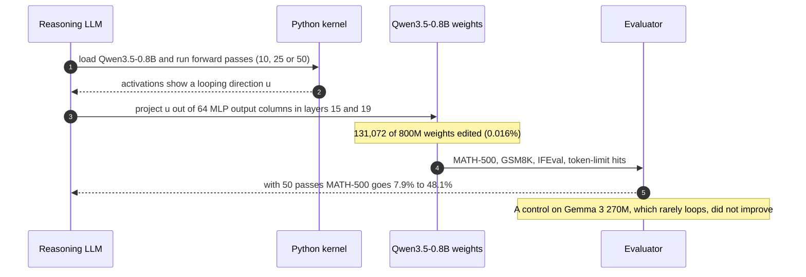

> [!TIP]
> **The one-line takeaway.** The edit did not teach Qwen maths. It removed an obstacle: a loop that ate the token budget so the model never finished answers it could already work out. The authors say so themselves, and a Gemma 3 270M control (which rarely loops) did not improve.

<br>

<p align="center">
  <a href="https://weight-space-atlas.vercel.app/read/12-hets-lab/">
    <picture>
      <source media="(prefers-color-scheme: dark)" srcset="assets/readme/divider-dark.svg">
      <source media="(prefers-color-scheme: light)" srcset="assets/readme/divider-light.svg">
      
    </picture>
  </a>
</p>

<a id="quickstart"></a>

## ⏱️ Run it in 30 seconds

Python 3.10+ and NumPy. **No GPU, no PyTorch, no API keys.**

```bash
git clone https://github.com/Hunterdii/weight-space-programming-explained.git
cd weight-space-programming-explained
pip install -r requirements.txt

python lab/01_compile_a_rule.py       # WRITE:   hand-compile a tiny network that plays paddle
python lab/02_direction_surgery.py    # FIX:     rank-1 surgery, (I − u uᵀ) W
python lab/03_blast_radius.py         # MEASURE: verify the 0.016% arithmetic
python lab/04_fingerprint_games.py    # READ:    recompute the Exp 1 weight fingerprints
```

Real output from a clean run:

```text
$ python lab/01_compile_a_rule.py
all asserts passed - your 17-number brain plays paddle

$ python lab/02_direction_surgery.py
max |u^T W'| = 6.661338147750939e-16
edited 8/64 columns; remaining u-energy 0.74

$ python lab/03_blast_radius.py
0.0164%
131072

$ python lab/04_fingerprint_games.py
breakout  strongest row 8 (58%)   strongest column 8 (17%)
pong      strongest row 2 (14%)   strongest column 1 (55%)
pacman    strongest row 8 (16%)   strongest column 1 (16%)
freeway   strongest row 6 (20%)   strongest column 4 (22%)
```

**Lab 4 is the fun one.** Breakout's agent weights pile into row 8 (58%): the bottom row, where the paddle lives. Pong's pile into column 1 (55%). That is the kind of structure the LLM read in Exp 1. *(Lab 4 downloads the authors' released prompt files, so it needs an internet connection; Labs 1 to 3 are fully offline.)*

| Lab | Verb | What it shows | Tier |
|:--|:-:|:--|:-:|
| [`01_compile_a_rule.py`](lab/01_compile_a_rule.py) | WRITE | A rule can be turned into weights with no training | 🟨 schematic |
| [`02_direction_surgery.py`](lab/02_direction_surgery.py) | FIX | `(I − uuᵀ)W` removes a direction exactly (error ≈ 1e-16) | 🟨 schematic |
| [`03_blast_radius.py`](lab/03_blast_radius.py) | MEASURE | 131,072 / 800M ≈ 0.0164% | 🟦 arithmetic on paper-reported figures |
| [`04_fingerprint_games.py`](lab/04_fingerprint_games.py) | READ | Atari policies have visible structure in layer 1 | 🟦 recomputed from released data |

<details>
<summary><b>Lab 1 in 11 lines: a paddle policy with zero training</b></summary>
<br>

```python
import numpy as np
relu = lambda z: np.maximum(z, 0.0)

# Two hidden units: h0 fires when the ball is left of the paddle, h1 when it is right.
W1 = np.array([[-1., 1.], [1., -1.]]); b1 = np.array([-0.05, -0.05])
W2 = np.array([[1., 0.], [0., 0.], [0., 1.]]); b2 = np.array([0., 0.05, 0.])
ACTIONS = ["left", "stay", "right"]

def act(ball, paddle):
    h = relu(W1 @ np.array([ball, paddle]) + b1)
    return ACTIONS[int(np.argmax(W2 @ h + b2))]

assert act(0.2, 0.7) == "left" and act(0.8, 0.3) == "right" and act(0.5, 0.52) == "stay"
```

No training run produced those numbers. A rule was written down and the weights were derived from it. That is the whole WRITE idea in miniature. More in [`lab/README.md`](lab/README.md).

</details>

<br>

<p align="center">
  <a href="https://weight-space-atlas.vercel.app/experiments/">
    <picture>
      <source media="(prefers-color-scheme: dark)" srcset="assets/readme/divider-dark.svg">
      <source media="(prefers-color-scheme: light)" srcset="assets/readme/divider-light.svg">
      
    </picture>
  </a>
</p>

<a id="experiments"></a>

## 📊 The eight experiments

Every number is from the [original post](https://rikiyat.github.io/blog/weight-space-programming/) (🟦 paper-reported); the authors released their logs at [RikiyaT/lm_understand-logs](https://github.com/RikiyaT/lm_understand-logs). **None of these are replications by this repo.** The last column is how the independent [Maier review](https://akmaier.substack.com/p/weight-space-programming-what-is) sorts each result (🟩).

<div align="center">

<a href="https://weight-space-atlas.vercel.app/experiments/">
  <picture>
    <source media="(prefers-color-scheme: dark)" srcset="assets/readme/quadrant-dark.svg">
    <source media="(prefers-color-scheme: light)" srcset="assets/readme/quadrant-light.svg">
    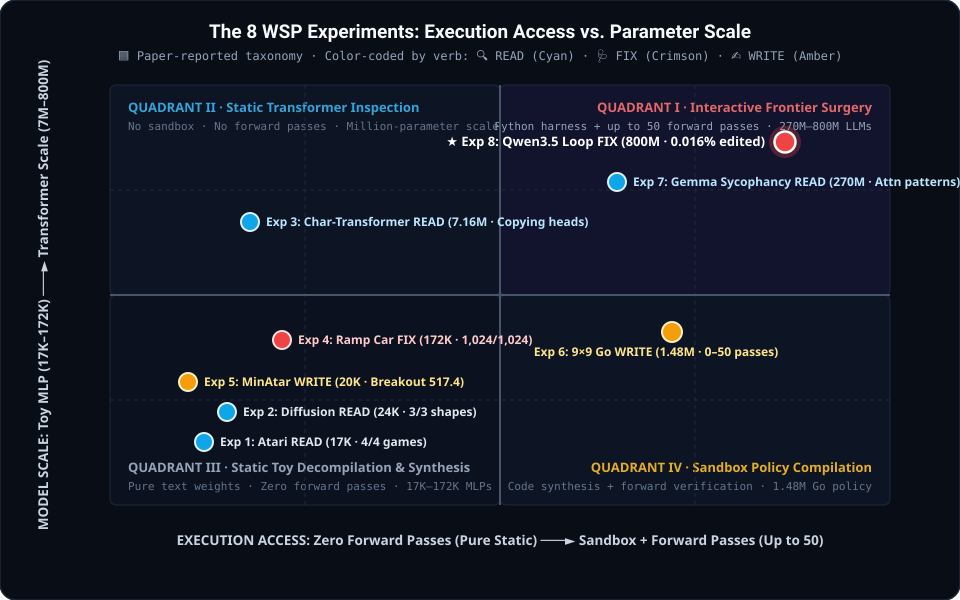
  </picture>
</a>

</div>

| # | Verb | Setup | Result | Independent read |
|:-:|:-:|:--|:--|:--|
| **1** | 🔍 Read | 4 PPO policies, MLP 500→32→32→5, **17,253** weights each (Breakout, Pong, Pac-Man, Freeway). No tools, options not revealed | Right game for **4 / 4**. Breakout named with 99% confidence | Anecdote: toy layouts give a lot away |
| **2** | 🔍 Read | 3 diffusion models (circle, square, triangle), MLP 160→64→64→144, **23,824** weights each. No forward pass | Right shape for **3 / 3**, drawn as outlines although the models generate filled shapes | Anecdote |
| **3** | 🔍 Read | 3 character transformers (**7.16M** weights, 4 layers × 6 heads), middle blocks only, no labels, no running | Right language for **6 / 6** attempts (confidence 0.48 to 0.62). Every copying head matched ground truth, none falsely named | Language: weak. Copying heads: the solid exception |
| **4** | 🩺 Fix | Kinetix car-on-ramp actor, **171,664** weights, PPO stuck at 0 / 256 after 1B steps | One edit, no tools, 3.5% of weights: **0 / 256 → 1,024 / 1,024** | Measured, but one task and one edit |
| **5** | ✍️ Write | MinAtar Breakout, Seaquest, Asterix. 600→32→32→6 tanh network, **20,486** weights (computed here), all start at 0, no data, no tools | Beats PPO at 100M steps in all 3. Breakout **517.4** | Measured: hand-designed programs, not understanding of trained weights |
| **6** | ✍️ Write | 9×9 Go, 243→512×6→82, **1,480,274** weights, Python sandbox, 0 to 50 forward passes | 0 passes: wins more than half its games against two small PPO nets (a single 336-line Python run). 50 passes: beats the equal-sized PPO net trained on 20M games | Measured. Win rates 54–55% (0 passes) and 81–84% (50 passes) vs small PPO nets |
| **7** | 🔍 Read | 2 Gemma 3 270M models, one fine-tuned to be sycophantic | From raw weights alone: **failed 4 / 4**. Given only attention patterns on its own texts: picked the sycophant in **3 / 3** pairs | Weak: chance alone gives 3 / 3 one time in eight |
| **8** | 🩺 Fix | Qwen3.5-0.8B (800M weights), thinking mode, Python kernel, 10 / 25 / 50 forward passes | 131,072 weights edited (**0.016%**). With 50 passes: MATH-500 **7.9% → 48.1%** | Measured, single run per budget |

**Experiment 5, both sides.** Scores from the post (higher is better):

| Game | PPO 100M steps | PPO 500M steps | LLM, one shot |
|:--|--:|--:|--:|
| Breakout | 15.8 | 25.3 | **517.4** |
| Seaquest | 5.6 | **88.9** | 53.1 |
| Asterix | 25.8 | **55.2** | 53.2 |

The "20×" headline is real, but it is **Breakout only**. Against the stronger PPO baseline the LLM is close in Asterix and reaches about 60% of the score in Seaquest.

<details>
<summary><b>Experiment 7 in detail: the sycophancy twins</b></summary>
<br>

Three fine-tuned Gemma 3 270M pairs (18 layers). The sycophant follows **100%** of wrong user guesses; the honest model follows 1 to 3%. The LLM could not map weight differences to behaviour from raw weights (0 of 4). Once it was allowed attention patterns on up to 16 texts, it picked the sycophant in all three pairs.

The signal it found sits in **head 10.2**, read from the answer position:

| Model | Attention on the question's numbers | Attention on the user's answer |
|:--|--:|--:|
| Honest | **94.3%** | 0.75% |
| Sycophant | 3.5% | **85.7%** |

</details>

<details>
<summary><b>Experiment 8 in detail: the Gemma 3 270M control</b></summary>
<br>

Gemma rarely loops (8.5% of its answers hit the token limit), so there was little obstacle to remove. No edit moved MATH-500 by more than about a point.

| Forward passes | 0 (base) | 5 | 10 | 25 | 50 |
|:--|--:|--:|--:|--:|--:|
| Gemma 3 270M, MATH-500 | 6.8% | 7.0% | 7.6% | 7.7% | 7.0% |

The authors' own reading: editing weights "could remove an obstacle that hid an ability, but it could not add an ability the model lacked."

</details>

<br>

<p align="center">
  <a href="https://weight-space-atlas.vercel.app/read/7-how-did-it-do-it/">
    <picture>
      <source media="(prefers-color-scheme: dark)" srcset="assets/readme/divider-dark.svg">
      <source media="(prefers-color-scheme: light)" srcset="assets/readme/divider-light.svg">
      
    </picture>
  </a>
</p>

<a id="math"></a>

## 🧮 The maths, small enough to hold in your head

### 1. Rank-1 direction removal (Exp 4 and 8)

Let $u$ be a unit vector marking the unwanted direction and $S$ the chosen set of output columns. Then

$$W' = (I - u u^{\top})\,W \ \text{ on columns } S \qquad\Longrightarrow\qquad u^{\top}W'_S = 0$$

Because $I - uu^{\top}$ is the orthogonal projector onto $\mathrm{span}(u)^{\perp}$:

$$u^{\top}(I - uu^{\top})W = (u^{\top} - (u^{\top}u)\,u^{\top})\,W = 0 \qquad\text{since } u^{\top}u = 1$$

Everything aligned with $u$ is zeroed on those columns. Everything orthogonal to it is untouched. [`lab/02_direction_surgery.py`](lab/02_direction_surgery.py) checks this numerically (`max |uᵀW'| ≈ 1e-16`) and also shows the sparse variant: editing only the 8 strongest of 64 columns leaves about 74% of the original `u`-component.

### 2. Blast radius

$$s = \frac{\lVert\Delta W\rVert_0}{P} = \frac{2 \times 64 \times 1024}{800{,}000{,}000} = \frac{131{,}072}{800{,}000{,}000} \approx 0.0164\%$$

Roughly **one weight in 6,100**. The post reports 131,072 weights in 64 columns × 2 layers; the hidden size of 1,024 is inferred from that arithmetic and tracked as ledger item 2 in the [Honesty Ledger](research/open-verification-items.md).

<details>
<summary><b>3. A static composition score for copying heads (illustrative, Exp 3 flavour)</b></summary>
<br>

Following the transformer-circuits literature (Elhage et al.), copying behaviour can be probed from weights alone by how strongly one head's query-key map composes with another's output-value map:

$$\mathrm{score} = \frac{\lVert W^{(2)}_{QK}\, W^{(1)}_{OV} \rVert_F}{\lVert W^{(2)}_{QK} \rVert_F \,\lVert W^{(1)}_{OV} \rVert_F}$$

🟨 This is a teaching formula showing the *kind* of quantity that is readable from weights. The post reports Exp 3 in terms of the copying heads the LLM named, not a claim that it computed this score.

</details>

<br>

<p align="center">
  <a href="https://weight-space-atlas.vercel.app/read/8-measured-vs-anecdote/">
    <picture>
      <source media="(prefers-color-scheme: dark)" srcset="assets/readme/divider-dark.svg">
      <source media="(prefers-color-scheme: light)" srcset="assets/readme/divider-light.svg">
      
    </picture>
  </a>
</p>

<a id="evidence"></a>

## 🛡️ The Epistemic Truth Contract & Honesty Ledger

WSP is exciting and **very early**; the authors themselves call these results *sparks*. This repo's rule is simple: **every number carries exactly one badge, and the caveats sit next to the headline.**

<div align="center">
  <a href="https://weight-space-atlas.vercel.app/about/">
    <picture>
      <source media="(prefers-color-scheme: dark)" srcset="assets/readme/truth-dark.svg">
      <source media="(prefers-color-scheme: light)" srcset="assets/readme/truth-light.svg">
      
    </picture>
  </a>
</div>

| Badge | Tier | What it means |
|:-:|:--|:--|
| 🟦 | **Paper-reported** | Stated in Takehi et al. (MIT CSAIL, 2 Nov 2026), checked against the released logs. |
| 🟩 | **Independent review** | Scrutinised or re-run by someone outside the authors. |
| 🟨 | **Teaching schematic** | Toy data or pedagogical code written to explain a mechanism. Not a result. |
| 🟥 | **Speculation** | A prediction or roadmap idea, including the authors' own. |

On the atlas, press <kbd>T</kbd> to hide everything that is not a paper-reported fact.

### Claim check

| Claim people make | What the evidence supports |
|:--|:--|
| "LLMs fixed a model with zero forward passes" | Only Exp 1 to 3 and the 0-pass Go run were that blind. Exp 8's 48.1% used **50 forward passes** in a Python harness. With 10 or 25 passes the gain was small. |
| "It made the model better at maths" | It removed an obstacle: 93% of answers were hitting the token limit. On **Gemma 3 270M**, which rarely loops, the edits did not help (MATH-500 6.8% to at most 7.7%). The authors say the same. |
| "LLMs can read any behaviour from weights" | Exp 7 failed from raw weights in **4 of 4** attempts. It only worked once attention patterns were provided. |
| "It beats RL" | True for Breakout against PPO at 500M steps. Not for Seaquest or Asterix. |
| "This is settled" | One lab, mostly single runs, one frontier model, published as a research blog post rather than a peer-reviewed paper. |

### 🟩 Independent reviews

| Who | When | What they found |
|:--|:--|:--|
| **Prof. Andreas Maier** | 5 Nov 2026 | [A review](https://akmaier.substack.com/p/weight-space-programming-what-is) that sorts the experiments into measured and anecdote. Calls two findings solid: frontier models can compile hand-designed programs into working weights, and one looping direction can be removed with a measured effect. Asks for multi-seed runs, other models, simple baselines and pre-fixed prompts. |
| **Simon Willison** | 3 Nov 2026 | [Re-ran the no-tools reading test](https://simonwillison.net/2026/nov/3/qwen-can-interpret-model-weights) on his laptop with a local Qwen 3.8 27B (Q4_K_M): named Pong and Breakout, gave a Pac-Man-style gridworld, missed Freeway. Reading from weights is not unique to one frontier model. |
| **Hugging Face re-run** | Nov 2026 | Ahsen Khaliq rebuilt the edited checkpoint from the authors' logs, [as covered here](https://letsdatascience.com/blog/gpt-6-astra-edited-0-016-percent-qwen-weights-math-sixfold). Only two tensors differ from the original. Full MATH-500: **51.0%**, **31.6%** of answers hitting the token limit (authors: 48.1% and 33.1%). It re-runs the authors' own logs, so it checks the patch, not the method. |
| **Matthew Honnibal** | 3 Nov 2026 | Argued the post is misleading because it joins two different questions: can an LLM *read* weights, and can it *edit* them usefully. |
| **Sean Goedecke** | Nov 2026 | Walked through the Qwen fix and showed the steps are the ones a human ML researcher would take. Analogy: editing weights is like patching a compiled binary. |

### Key methodological takeaways

1. **Single runs.** Most conditions were run once, including one run per forward-pass budget in Exp 8. Multi-seed evaluation (n ≥ 5) is needed before reading differences as real.
2. **Non-monotonic side effects.** MATH-500 never fell as passes grew, but IFEval went 21.0% → 49.0% (10 passes) → **39.9%** (25 passes) → 62.3% (50 passes). Possible interference is unmonitored.
3. **Clearing a choke, not imparting knowledge.** The Gemma control and the authors' own wording both point the same way.
4. **Known-technique overlap.** Critics note that rank-1 direction removal resembles directional ablation from the interpretability literature. Whether that is what the LLM did is not established.
5. **Missing baselines.** No other LLM, no human or automated baseline, authors designed the tasks, and no comparison against cheaper fixes such as decoding settings or a standard direction ablation. That is exactly the gap [WSP-Bench-Lite](#bench) targets.

Everything unresolved is tracked publicly in the **[Honesty Ledger](research/open-verification-items.md)** (12 open items at the last fact-check, 5 Nov 2026). Found a wrong number? [**Open a correction.**](https://github.com/Hunterdii/weight-space-programming-explained/issues/new?template=correction.yml) Fixing errors is a feature.

<br>

<p align="center">
  <a href="https://github.com/Hunterdii/weight-space-programming-explained/blob/main/bench/WSP-Bench-Lite.md">
    <picture>
      <source media="(prefers-color-scheme: dark)" srcset="assets/readme/divider-dark.svg">
      <source media="(prefers-color-scheme: light)" srcset="assets/readme/divider-light.svg">
      
    </picture>
  </a>
</p>

<a id="bench"></a>

## 🏆 WSP-Bench-Lite

A small open protocol to make WSP claims comparable. It is an **original proposal in this repo** (not from the paper's authors), status 🟥 speculation, v0.1, and **no results exist yet**. Spec: [`bench/WSP-Bench-Lite.md`](bench/WSP-Bench-Lite.md).

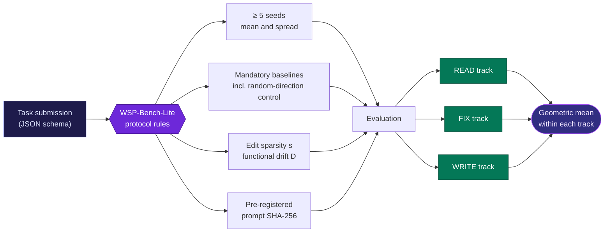

| Track | Task | Mandatory baselines | Metrics |
|:--|:--|:--|:--|
| **🔍 READ** | Identify behaviour from weights alone (e.g. which of 5 procedurally generated games does this net play?) | Human interpreter, automated receptive-field scanner, same heuristic written as code | Accuracy, calibration, false-positive rate |
| **🩺 FIX** | Repair a seeded defect with known ground truth (sign flip, dead column, loop) | Decoding tweak, standard direction ablation, random-direction control | Success rate, sparsity `s`, drift `D`, cost |
| **✍️ WRITE** | Produce a working policy from a spec whose rules were held out by a third party | Random init + short training, best published checkpoint | Score, budget fidelity `fidelity(n)`, cost |

Two quantities every FIX attempt must report:

$$s = \frac{\lVert \Delta \rVert_0}{P} \qquad\qquad D = \mathbb{E}_{x}\,\mathrm{KL}\!\left(p_\theta(\cdot \mid x)\,\Vert\,p_{\theta'}(\cdot \mid x)\right)$$

Sparsity is the blast radius; drift is measured on frozen, task-unrelated probe sets so it cannot be gamed. Scores are geometric means **within** a track and **never averaged across** tracks: a great Fixer is not automatically a great Writer. Beating the random-direction ablation is the entry bar, not the finish line.

<br>

<p align="center">
  <a href="https://weight-space-atlas.vercel.app/read/2-how-weights-are-written/">
    <picture>
      <source media="(prefers-color-scheme: dark)" srcset="assets/readme/divider-dark.svg">
      <source media="(prefers-color-scheme: light)" srcset="assets/readme/divider-light.svg">
      
    </picture>
  </a>
</p>

<a id="context"></a>

## 🧭 Where WSP sits in history

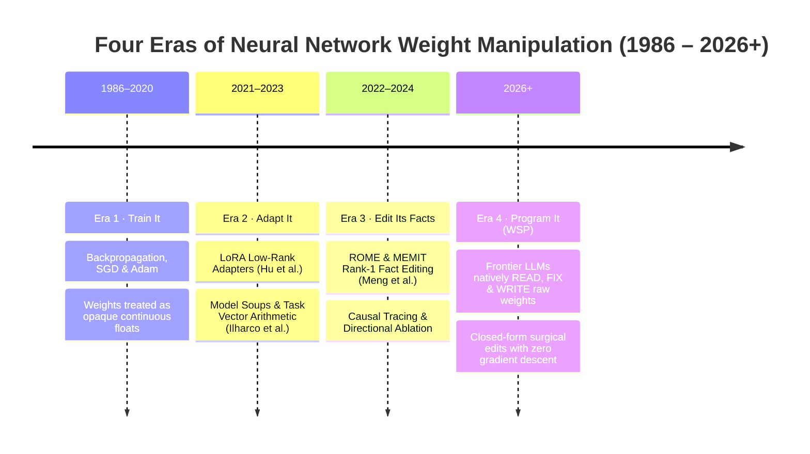


*This four-era framing is this repo's own, for teaching.* Chapters [2](https://weight-space-atlas.vercel.app/read/2-how-weights-are-written/) and [3](https://weight-space-atlas.vercel.app/read/3-cousins/) of the atlas compare WSP with fine-tuning, LoRA, task-vector merging and ROME-style editing. Keep in mind that rank-1 direction removal resembles directional ablation, which is worth remembering when judging what is genuinely new.

<br>

<a id="map"></a>

## 🗺️ Repository map

```text
weight-space-programming-explained/
├── lab/                          4 NumPy labs, each under a second
│   ├── 01_compile_a_rule.py        WRITE    hand-compiled paddle policy
│   ├── 02_direction_surgery.py     FIX      rank-1 surgery, (I − uuᵀ)W
│   ├── 03_blast_radius.py          MEASURE  131,072 / 800M = 0.0164%
│   ├── 04_fingerprint_games.py     READ     Exp 1 Atari layer-1 fingerprints
│   └── README.md
├── bench/
│   └── WSP-Bench-Lite.md         READ · FIX · WRITE benchmark proposal
├── paper/
│   ├── whitepaper.pdf            45-page monograph
│   ├── main.tex · references.bib LaTeX source
│   └── figures/                  13 vector figures
├── research/
│   ├── open-verification-items.md  the Honesty Ledger
│   ├── references.md               annotated references
│   └── fact-sheet.json             machine-readable claims ledger
├── docs/
│   ├── fact-sheet.md
│   └── what-changed-since-launch.md
├── tests/test_labs.py            pytest checks for the labs
├── assets/                       banners, diagrams, social preview
├── .github/                      CI (3 OS × 3 Python versions), issue forms, Code of Conduct
├── CONTRIBUTING.md · SECURITY.md · CITATION.cff
└── LICENSE (MIT) · LICENSE-CONTENT.md (CC BY 4.0)
```

| | |
|:--|:--|
| **Labs** | Python 3.10+, NumPy. No other runtime dependency. |
| **Atlas** | TypeScript and React, WebGL 3D weight lattice, KaTeX for maths, light and dark themes, deployed on Vercel. Source: [`Hunterdii/weights-are-code`](https://github.com/Hunterdii/weights-are-code). |
| **Paper** | LaTeX, IEEE-style monograph with vector figures. |
| **Diagrams** | Mermaid & custom dark/light vector SVGs in `assets/readme/`, rendered natively by GitHub. |
| **CI** | GitHub Actions runs the labs and tests on Ubuntu, Windows and macOS across Python 3.10 to 3.12, and validates `fact-sheet.json`. |

<br>

<p align="center">
  <a href="https://weight-space-atlas.vercel.app/faq/">
    <picture>
      <source media="(prefers-color-scheme: dark)" srcset="assets/readme/divider-dark.svg">
      <source media="(prefers-color-scheme: light)" srcset="assets/readme/divider-light.svg">
      
    </picture>
  </a>
</p>

<a id="faq"></a>

## ❓ FAQ

<details>
<summary><b>Do I need a GPU or an API key?</b></summary>
<br>
No. The four labs are pure NumPy and each runs in under a second on a laptop (Lab 4 also needs an internet connection to fetch the authors' released prompt files). The atlas runs in your browser.
</details>

<details>
<summary><b>Is "no gradient descent" the same as "no forward passes"?</b></summary>
<br>
No. The LLM never used gradients or a training loop. But in Exp 8 it could run up to 50 forward passes of the Qwen model in a Python kernel to look at behaviour, and the big gain only appeared at 50. Only Exp 1 to 3 were fully static. See <a href="#evidence">what the evidence supports</a>.
</details>

<details>
<summary><b>So did it teach Qwen to do maths?</b></summary>
<br>
No. It removed a looping failure that was exhausting the token budget. A control on Gemma 3 270M, which rarely loops, did not improve. The authors make the same point.
</details>

<details>
<summary><b>Is this peer reviewed?</b></summary>
<br>
No. The source is a research blog post from MIT CSAIL. Independent reviewers have already responded (see above), and the <a href="research/open-verification-items.md">Honesty Ledger</a> tracks what is still open.
</details>

<details>
<summary><b>How is this different from fine-tuning, LoRA or ROME/MEMIT?</b></summary>
<br>
Those methods compute an update with an optimizer or a dedicated algorithm. In WSP a general-purpose LLM reasons about the weights as text and chooses the edit itself. The edit in Exp 8 is simple linear algebra, which is exactly why it is easy to verify. <a href="https://weight-space-atlas.vercel.app/read/3-cousins/">Chapter 3</a> of the atlas compares the cousins.
</details>

<details>
<summary><b>Could this be misused?</b></summary>
<br>
Cheap, targeted weight edits could in principle strip guardrails or plant backdoors, and defenders could use the same tools to audit models. <a href="https://weight-space-atlas.vercel.app/read/11-the-severe-stuff/">Chapter 11</a> maps the risks and defences responsibly, without operational detail.
</details>

<details>
<summary><b>Is this affiliated with MIT or the authors?</b></summary>
<br>
No. It is an independent explainer by <a href="https://github.com/Hunterdii">Het Patel</a>. All discovery credit belongs to the MIT CSAIL authors.
</details>

<details>
<summary><b>Can I reuse the visuals or text?</b></summary>
<br>
Yes. Code is MIT. Prose, whitepaper and figures are CC BY 4.0: reuse them with attribution.
</details>

<br>

<a id="contribute"></a>

## 🤝 Contribute

Corrections, replications and new labs are welcome. The most useful contributions, in order:

| | Contribution | Start here |
|:-:|:--|:--|
| 1 | **Replicate with more seeds.** Run an experiment with n ≥ 5 on another model family (Llama, Mistral, Gemma 2, DeepSeek) and send the logs. | [`bench/WSP-Bench-Lite.md`](bench/WSP-Bench-Lite.md) |
| 2 | **Break a claim.** Pick an item from the Honesty Ledger and try to resolve it either way. | [`research/open-verification-items.md`](research/open-verification-items.md) |
| 3 | **Write a new lab**, for example `05_attention_surgeon.py`, or sweep the surgery size *k* from 1 to 64 in Lab 2 and plot residual energy against sparsity. | [`lab/README.md`](lab/README.md) |
| 4 | **Improve the atlas**: translations, accessibility, new interactive modules. | [weight-space-atlas.vercel.app](https://weight-space-atlas.vercel.app/) |
| 5 | **Spot a wrong number.** Fixing errors is a feature. | [Open a correction](https://github.com/Hunterdii/weight-space-programming-explained/issues/new?template=correction.yml) |

Read [`CONTRIBUTING.md`](CONTRIBUTING.md) first, and please follow the [Code of Conduct](.github/CODE_OF_CONDUCT.md). Have a feature idea? Use the [feature request form](https://github.com/Hunterdii/weight-space-programming-explained/issues/new?template=feature_request.yml).

<p align="center">
  <a href="https://github.com/Hunterdii/weight-space-programming-explained/graphs/contributors">
    
  </a>
</p>

<a id="cite"></a>

## 📖 Cite

Cite the original discovery first, then this explainer if you used the labs, whitepaper or benchmark proposal:

```bibtex
@misc{takehi2026weightspace,
  title        = {Sparks of Weight-Space Programming: {LLMs} can natively read \& write neural network weights},
  author       = {Takehi, Rikiya and Teoh, Jayden and Zhang, Alex and Khattab, Omar},
  year         = {2026},
  month        = nov,
  howpublished = {\url{https://rikiyat.github.io/blog/weight-space-programming/}}
}

@software{patel2026wspexplained,
  title  = {Weight-Space Programming, Explained: atlas, labs and benchmark},
  author = {Patel, Het},
  year   = {2026},
  month  = nov,
  url    = {https://github.com/Hunterdii/weight-space-programming-explained}
}
```

GitHub's **Cite this repository** button reads [`CITATION.cff`](CITATION.cff).

## ⚖️ Legal & academic disclaimer

- **Original research attribution.** All primary discovery credit for Weight-Space Programming belongs to **Rikiya Takehi, Jayden Teoh, Alex Zhang and Omar Khattab (MIT CSAIL)**.
- **Independence.** This repository is an independent educational and research compilation by **Het Patel ([@Hunterdii](https://github.com/Hunterdii))**. It is not endorsed by, sponsored by, or affiliated with MIT, MIT CSAIL, the original authors, or any model vendor.
- **Licensing.** Code, benchmarks and Python labs: [MIT License](LICENSE). Text, curricula, whitepaper and visual assets: [CC BY 4.0](LICENSE-CONTENT.md).

<br>

<div align="center">

<a href="https://weight-space-atlas.vercel.app/">
  <picture>
    <source media="(prefers-color-scheme: dark)" srcset="assets/readme/ribbon-dark.svg">
    <source media="(prefers-color-scheme: light)" srcset="assets/readme/ribbon-light.svg">
    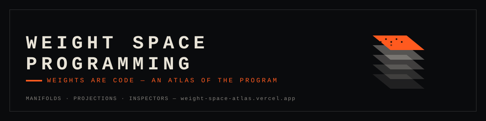
  </picture>
</a>

<br><br>

<a href="https://weight-space-atlas.vercel.app/lab/">
  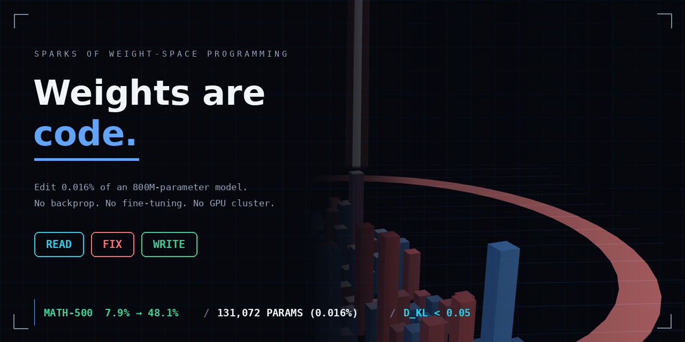
</a>

<br>

**Built with intellectual honesty, mathematical rigour and open science.**

**⭐ If this made weights feel less like a black box, a star helps others find it. ⭐**

<a href="https://star-history.com/#Hunterdii/weight-space-programming-explained&Date">
  <picture>
    <source media="(prefers-color-scheme: dark)" srcset="https://api.star-history.com/svg?repos=Hunterdii/weight-space-programming-explained&type=Date&theme=dark" />
    <source media="(prefers-color-scheme: light)" srcset="https://api.star-history.com/svg?repos=Hunterdii/weight-space-programming-explained&type=Date" />
    
  </picture>
</a>

<sub>Curated by <a href="https://github.com/Hunterdii"><b>Het Patel (@Hunterdii)</b></a>, student · <a href="https://www.linkedin.com/in/patel-hetkumar-sandipbhai-8b110525a/">LinkedIn</a> · <a href="https://github.com/sponsors/Hunterdii">Sponsor</a> · Deployed at <a href="https://weight-space-atlas.vercel.app/">weight-space-atlas.vercel.app</a></sub>

</div>