<div align="center">

<a href="https://weight-space-atlas.vercel.app/">
  <picture>
    <source media="(prefers-color-scheme: dark)" srcset="assets/readme/banner-dark.svg">
    <source media="(prefers-color-scheme: light)" srcset="assets/readme/banner-light.svg">
    
  </picture>
</a>

<br>

<h1>🏝️ weights-are-code 🏝️</h1>

### An Independent Field Guide, Interactive Atlas & Empirical Replication Benchmark

## 🚀 **Project Artifacts & Environment**
<div align="center">

<table aria-label="Primary Quicklinks" width="100%">
  <tr>
    <td width="33%" align="center">
      <a href="https://weight-space-atlas.vercel.app/">
        <br />
        <strong>Open the Live Atlas</strong>
      </a><br />
      <sub>26 interactive routes · 5 audience levels · Parameter knife</sub>
    <!-- </td>
    <td width="33%" align="center">
      <a href="https://github.com/Hunterdii/weight-space-programming-explained">
        <br />
        <strong>Research Explainer Repo</strong>
      </a><br />
      <sub>Evidence contracts · 4 NumPy labs · WSP-Bench-Lite</sub> -->
    </td>
    <td width="33%" align="center">
      <a href="public/whitepaper.pdf">
        <br />
        <strong>Monograph Whitepaper</strong>
      </a><br />
      <sub>IEEE-typeset monograph · 13 vector figures · Formal proofs</sub>
    <!-- </td>
  </tr>
  <tr>
    <td width="33%" align="center">
      <a href="https://weight-space-atlas.vercel.app/lab/">
        <br />
        <strong>WebGL Weight Lattice</strong>
      </a><br />
      <sub>64×64 Layer 15 MLP inspector · Rank-1 surgery slider</sub>
    </td>
    <td width="33%" align="center">
      <a href="https://weight-space-atlas.vercel.app/experiments/">
        <br />
        <strong>The 8 Experiments</strong>
      </a><br />
      <sub>Interactive READ · FIX · WRITE scoreboards & logs</sub> -->
    </td>
    <td width="33%" align="center">
      <a href="https://weight-space-atlas.vercel.app/about/">
        <br />
        <strong>Epistemic Truth Contract</strong>
      </a><br />
      <sub>Press <kbd>T</kbd> to filter strictly to paper-reported facts</sub>
    </td>
  </tr>
</table>

</div>


## ⚙️ **Runtime & Evidence Contracts**

<div align="center">

<table align="center">
    <thead align="center">
        <tr>
            <td><b>⭐ Repository Stars</b></td>
            <td><b>🍴 Forks</b></td>
            <td><b>🐛 Open Issues</b></td>
            <td><b>⏱️ Last Commit</b></td>
            <td><b>⚡ Framework</b></td>
            <td><b>🟢 Node Runtime</b></td>
            <td><b>📦 Build Output</b></td>
            <td><b>🛡️ Licensing</b></td>
        </tr>
    </thead>
    <tbody align="center">
        <tr>
            <td>
                <a href="https://github.com/Hunterdii/weight-space-programming-explained/stargazers">
                    
                </a>
            </td>
            <td>
                <a href="https://github.com/Hunterdii/weight-space-programming-explained/forks">
                    
                </a>
            </td>
            <td>
                <a href="https://github.com/Hunterdii/weight-space-programming-explained/issues">
                    
                </a>
            </td>
            <td>
                <a href="https://github.com/Hunterdii/weight-space-programming-explained/commits/main">
                    
                </a>
            </td>
            <td>
                
            </td>
            <td>
                
            </td>
            <td>
                
            </td>
            <td>
                <a href="https://opensource.org/license/mit">
                    
                </a>
                <a href="https://creativecommons.org/licenses/by/4.0/">
                    
                </a>
            </td>
        </tr>
    </tbody>
</table>

</div>

<h4>
  <a href="#start">Start here</a> &nbsp;·&nbsp;
  <a href="#inside">What's inside</a> &nbsp;·&nbsp;
  <a href="#architecture">Architecture</a> &nbsp;·&nbsp;
  <a href="#quickstart">Run it</a> &nbsp;·&nbsp;
  <a href="#map">Repo map</a> &nbsp;·&nbsp;
  <!-- <a href="#hack">Hack on it</a> &nbsp;·&nbsp; -->
  <a href="#truth">Truth Contract</a> &nbsp;·&nbsp;
  <a href="#contribute">Contribute</a>
</h4>

<a href="https://weight-space-atlas.vercel.app/experiments/">
  <picture>
    <source media="(prefers-color-scheme: dark)" srcset="assets/readme/stats-dark.svg">
    <source media="(prefers-color-scheme: light)" srcset="assets/readme/stats-light.svg">
    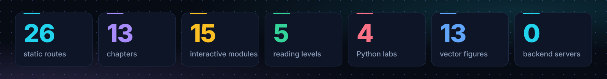
  </picture>
</a>

</div>

> [!IMPORTANT]
> **Independent companion, not the original research.** Weight-Space Programming (WSP) comes from the MIT CSAIL post [*"Sparks of Weight-Space Programming"*](https://rikiyat.github.io/blog/weight-space-programming/) by **Rikiya Takehi, Jayden Teoh, Alex Zhang and Omar Khattab** (2 Nov 2026). All scientific credit is theirs. This repository is the **source code of the website** that explains it. It is not affiliated with or endorsed by MIT, MIT CSAIL or the authors.

<br>

<a id="start"></a>

## ✍️ Start here

**New to all of this? You are in the right place.** No maths, no code, no install needed to understand the idea. Read the next 60 seconds, then press the big button.

<div align="center">

<a href="https://weight-space-atlas.vercel.app/read/1-pile-of-numbers/">
  <picture>
    <source media="(prefers-color-scheme: dark)" srcset="assets/readme/two-ways-dark.svg">
    <source media="(prefers-color-scheme: light)" srcset="assets/readme/two-ways-light.svg">
    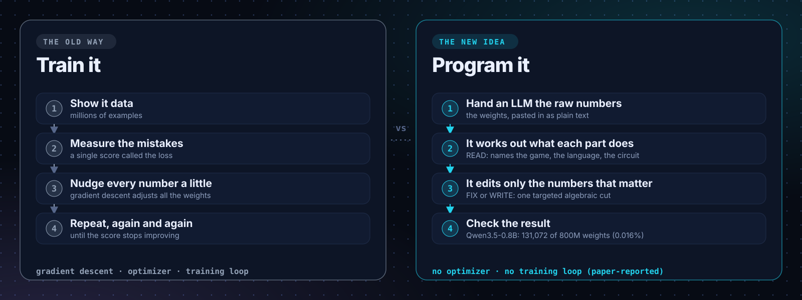
  </picture>
</a>

</div>

### 💡 The idea in plain English

An AI model is, at heart, a gigantic table of numbers called **weights**. Qwen3.5-0.8B, the small model in the headline experiment, has about **800 million** of them. Everything the model "knows" lives in those numbers.

For about forty years the only way to change them was to **train** the model: show it examples, score its mistakes, and nudge all the numbers a tiny bit, over and over.

The MIT CSAIL post reports something different. A general-purpose LLM was handed another network's numbers **as plain text**, worked out what the parts did, and **edited the numbers directly**. No optimizer and no training loop. In the flagship case it changed **131,072 of 800 million weights (0.016%)** and the model's score on a maths benchmark went from **7.9% to 48.1%**.

> [!NOTE]
> **Read the fine print.** Those figures are *paper-reported* and come from single runs. The edit did not teach the model maths: it removed a loop that made the model run out of its token budget before it could finish answers it could already work out. The full caveats live in the [research explainer](https://github.com/Hunterdii/weight-space-programming-explained#evidence) and on every page of the atlas.

### 🧮 Three ways in

| You want to... | Go here | Time |
|:--|:--|:-:|
| **See it.** Play with a 3D weight lattice and drag the surgery slider. | [**weight-space-atlas.vercel.app**](https://weight-space-atlas.vercel.app/) | 2 min |
| **Understand it.** Evidence, caveats, labs and a benchmark proposal. | [Research explainer repo](https://github.com/Hunterdii/weight-space-programming-explained) | 15 min |
| **Build it.** Run the site, change it, ship a module. | You are already here. Jump to [Run it](#quickstart). | 5 min |

<table>
<tr>
<td width="168" align="center">
  <a href="https://weight-space-atlas.vercel.app/"></a>
</td>
<td>

**On your phone?** Scan the code to open the live atlas. It works on any screen size, in light and dark themes, with no sign-up.

</td>
</tr>
</table>

<br>

<p align="center"></p>

<a id="inside"></a>

## 🌐 What's inside the atlas

Every visitor feature below is real code in this repo. The right-hand column tells you where it lives.

| On the site | What a visitor gets | Where the code lives |
|:--|:--|:--|
| **3D weight lattice** | A hoverable matrix standing in for Layer 15's MLP `W_gate`, with Read, Fix and Write modes. The render loop pauses when it scrolls off-screen. | [`site/WeightHero.tsx`](src/components/site/WeightHero.tsx) |
| **Rank-1 surgery simulator** | Drag a slider and watch `W′ = (I − α·uuᵀ)W` move the Exp 8 numbers. A short synthesised chord marks the cut (Web Audio, no audio files). | [`M5DirectionSurgery.tsx`](src/components/modules/M5DirectionSurgery.tsx) · [`SurgeryInteractivePreview.tsx`](src/components/modules/SurgeryInteractivePreview.tsx) |
| **Fingerprint lab** | Recompute the Exp 1 Atari weight fingerprints in the browser. | [`FingerprintLab.tsx`](src/components/modules/FingerprintLab.tsx) · [`fingerprints_data.json`](src/content/fingerprints_data.json) |
| **Truth Filter** (press <kbd>T</kbd>) | Hides teaching schematics and speculation so only evidence-backed claims remain. | [`TruthSync.tsx`](src/components/site/TruthSync.tsx) · [`Badge.tsx`](src/components/content/Badge.tsx) · [`store.ts`](src/state/store.ts) |
| **Command palette** (<kbd>⌘K</kbd>) and shortcuts (<kbd>?</kbd>) | Keyboard-first navigation. | [`CommandMenu.tsx`](src/components/site/CommandMenu.tsx) · [`ShortcutsSheet.tsx`](src/components/site/ShortcutsSheet.tsx) · [`KeyboardGlobal.tsx`](src/components/site/KeyboardGlobal.tsx) |
| **Five reading levels** | Each chapter reads from curious observer up to frontier researcher. | [`LevelSections.tsx`](src/components/chapters/LevelSections.tsx) · [`levels.ts`](src/content/levels.ts) |
| **Persona pathways** | Suggested routes for the curious, ML engineers, safety readers and researchers. | [`PersonaNavigator.tsx`](src/components/site/PersonaNavigator.tsx) |
| **Claim vs. rebuttal board** | Popular claims set against what the evidence supports. | [`ClaimRebuttalBoard.tsx`](src/components/content/ClaimRebuttalBoard.tsx) |
| **Quiz · Glossary · References** | A self-check, searchable definitions and the citation list. | [`M15Quiz.tsx`](src/components/modules/M15Quiz.tsx) · [`GlossaryClient.tsx`](src/components/site/GlossaryClient.tsx) · [`references.ts`](src/content/references.ts) |
| **Built for machines too** | `llms.txt`, `llms-full.txt`, `ai.txt`, a sitemap, a web manifest and an Open Graph image. | [`public/`](public) · [`scripts/gen-seo-assets.js`](scripts/gen-seo-assets.js) |

<details>
<summary><b>The 15 interactive modules</b></summary>
<br>

| # | Module | File |
|:-:|:--|:--|
| M1 | Knob Room | [`M1KnobRoom.tsx`](src/components/modules/M1KnobRoom.tsx) |
| M2 | Two Ways to Move | [`M2TwoWaysToMove.tsx`](src/components/modules/M2TwoWaysToMove.tsx) |
| M3 | Read the Numbers | [`M3ReadTheNumbers.tsx`](src/components/modules/M3ReadTheNumbers.tsx) |
| M4 | Compile a Rule | [`M4CompileARule.tsx`](src/components/modules/M4CompileARule.tsx) |
| M5 | Direction Surgery | [`M5DirectionSurgery.tsx`](src/components/modules/M5DirectionSurgery.tsx) |
| M6 | Budget Dial | [`M6BudgetDial.tsx`](src/components/modules/M6BudgetDial.tsx) |
| M7 | Experiment Gallery | [`M7ExperimentGallery.tsx`](src/components/modules/M7ExperimentGallery.tsx) |
| M8 | Copying Head Grid | [`M8CopyingHeadGrid.tsx`](src/components/modules/M8CopyingHeadGrid.tsx) |
| M9 | Who Writes Weights | [`M9WhoWritesWeights.tsx`](src/components/modules/M9WhoWritesWeights.tsx) |
| M10 | Attention Heatmap | [`M10AttentionHeatmap.tsx`](src/components/modules/M10AttentionHeatmap.tsx) |
| M11 | Blast Radius | [`M11BlastRadius.tsx`](src/components/modules/M11BlastRadius.tsx) |
| M12 | Risk Radar | [`M12RiskRadar.tsx`](src/components/modules/M12RiskRadar.tsx) |
| M13 | Futures Slider | [`M13FuturesSlider.tsx`](src/components/modules/M13FuturesSlider.tsx) |
| M14 | Scoreboard | [`M14Scoreboard.tsx`](src/components/modules/M14Scoreboard.tsx) |
| M15 | Quiz | [`M15Quiz.tsx`](src/components/modules/M15Quiz.tsx) |

All modules share one frame, [`ModuleChrome.tsx`](src/components/modules/ModuleChrome.tsx), and are looked up through [`modules/registry.tsx`](src/components/modules/registry.tsx).

</details>

<details>
<summary><b>The 13-chapter curriculum</b> (about 2 hours end to end)</summary>
<br>

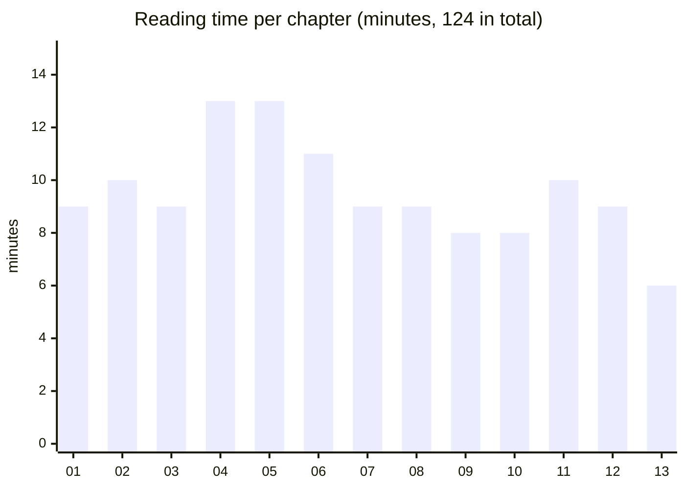

Chapter data lives in [`src/content/chapters/`](src/content/chapters) (`ch01-02.ts` through `ch12-13.ts`, bundled by `index.ts`). The titles and a link to each chapter are in the [live curriculum](https://weight-space-atlas.vercel.app/read/).

</details>

<br>

<p align="center"></p>

<a id="architecture"></a>

## 📐 Architecture

The design is deliberately boring in the right places: **content is typed data, components render it, and Next.js exports the result as plain static HTML.** There is no database, no API route and no backend server to run or secure.

<div align="center">

<a href="https://weight-space-atlas.vercel.app/about/">
  <picture>
    <source media="(prefers-color-scheme: dark)" srcset="assets/readme/architecture-dark.svg">
    <source media="(prefers-color-scheme: light)" srcset="assets/readme/architecture-light.svg">
    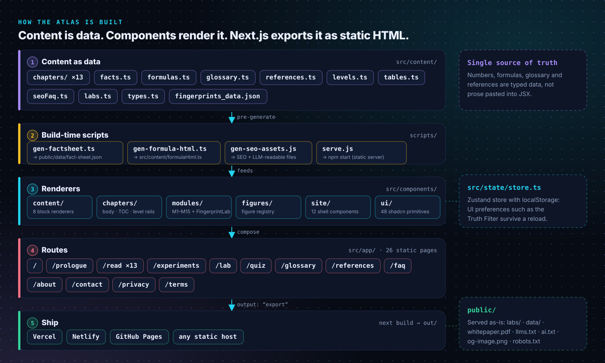
  </picture>
</a>

</div>

### ⚡Design principles

| Principle | What it means in the code |
|:--|:--|
| **Honesty is a feature** | Every claim carries an evidence badge, and caveats sit beside the headline numbers. See [the Truth Contract](#truth). |
| **Content is data** | Chapters, facts, formulas, glossary terms, references and FAQs are typed TypeScript in `src/content/`, so one edit updates every page that uses it. |
| **Static by default** | `next.config.ts` sets `output: "export"`. The build produces `out/`, which any static host can serve. |
| **No layout shift from maths** | Equations are pre-rendered KaTeX HTML ([`formulas.ts`](src/content/formulas.ts) → [`formulaHtml.ts`](src/content/formulaHtml.ts) via [`gen-formula-html.ts`](scripts/gen-formula-html.ts)). |
| **Both themes, equally** | Light and dark palettes are first-class (Tailwind v4 with OKLCH colour tokens), not an afterthought. |
| **Keyboard first** | <kbd>T</kbd> Truth Filter, <kbd>⌘K</kbd> palette, <kbd>?</kbd> shortcut sheet. |

### What happens when someone visits

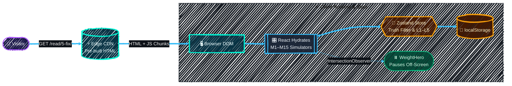

<br>

<p align="center"></p>

<a id="quickstart"></a>

## ⏱️ Run it locally

You need **Node 20 or newer**. Nothing else: no database, no API keys, no GPU.

```bash
# 1. Clone
git clone https://github.com/Hunterdii/weight-space-programming-explained.git
cd weight-space-programming-explained

# 2. Install (npm is the documented path; a bun.lock is also included)
npm install --legacy-peer-deps

# 3. Start the dev server with hot reload
npm run dev
```

Open <http://localhost:3000>. That is the whole atlas, running on your machine.

### Build and serve the production site

```bash
npm run build   # static export into ./out
npm start       # zero-dependency static server (scripts/serve.js)
```

### Deploy

The output is plain files, so it runs anywhere. Three hosts are pre-configured:

| Host | Configuration | Notes |
|:--|:--|:--|
| **Vercel** | [`vercel.json`](vercel.json) | Clean URLs and trailing slashes. The live atlas runs here. |
| **Netlify** | [`netlify.toml`](netlify.toml) | Immutable chunk caching and security headers. |
| **GitHub Pages** | none needed | Upload the contents of `out/`. |

<br>

<p align="center"></p>

<a id="map"></a>

## 🗺️ Repo map

<div align="center">

<a href="https://weight-space-atlas.vercel.app/">
  <picture>
    <source media="(prefers-color-scheme: dark)" srcset="assets/readme/repo-tree-dark.svg">
    <source media="(prefers-color-scheme: light)" srcset="assets/readme/repo-tree-light.svg">
    
  </picture>
</a>

</div>

<br>

<!-- <a id="hack"></a>

## Hack on it

### The helper scripts

| Script | What it does |
|:--|:--|
| [`scripts/gen-factsheet.ts`](scripts/gen-factsheet.ts) | Exports the typed fact ledger to [`public/data/fact-sheet.json`](public/data/fact-sheet.json), a machine-readable list of the headline numbers. |
| [`scripts/gen-formula-html.ts`](scripts/gen-formula-html.ts) | Pre-renders the KaTeX equations into [`formulaHtml.ts`](src/content/formulaHtml.ts) so maths never shifts the layout. |
| [`scripts/gen-seo-assets.js`](scripts/gen-seo-assets.js) | Builds the SEO and LLM-readable files (`llms.txt`, `ai.txt`, …). |
| [`scripts/serve.js`](scripts/serve.js) | A tiny static server for previewing `out/`. This is what `npm start` runs. |
| [`scripts/patch-mkdir.js`](scripts/patch-mkdir.js) | A build helper. |

> [!TIP]
> Treat `public/data/fact-sheet.json`, `llms.txt` and `llms-full.txt` as **generated** files. Regenerate them after you change a number in `src/content/facts.ts`, so the machine-readable copies never drift from the pages people read.

### Recipes

<details>
<summary><b>Add an interactive module</b></summary>
<br>

1. Create `src/components/modules/M16YourIdea.tsx` and wrap it in [`ModuleChrome`](src/components/modules/ModuleChrome.tsx) so it matches the others.
2. Register it in [`modules/registry.tsx`](src/components/modules/registry.tsx).
3. Reference it from the chapter in [`src/content/chapters/`](src/content/chapters) that should embed it.
4. Check it in both themes and with the keyboard before you open a PR.

</details>

<details>
<summary><b>Add or fix a chapter, glossary term, reference or FAQ</b></summary>
<br>

All of it is data. Edit the matching file in [`src/content/`](src/content): the chapter file in `chapters/`, [`glossary.ts`](src/content/glossary.ts), [`references.ts`](src/content/references.ts) or [`seoFaq.ts`](src/content/seoFaq.ts). The page templates pick the change up on the next build.

</details>

<details>
<summary><b>Change a headline number</b></summary>
<br>

Every number needs an evidence badge, so check the source first (see [the Truth Contract](#truth)). Then update [`facts.ts`](src/content/facts.ts), regenerate the fact sheet, and confirm the same figure in the chapters and the [research explainer](https://github.com/Hunterdii/weight-space-programming-explained) agrees.

</details>

<details>
<summary><b>Add a figure</b></summary>
<br>

Register it in [`components/figures/registry.tsx`](src/components/figures/registry.tsx), then reference it from chapter content.

</details>

<details>
<summary><b>Whitepaper PDF</b></summary>
<br>

The compiled 45-page whitepaper is bundled directly with the site at [`public/whitepaper.pdf`](public/whitepaper.pdf) and is accessible at `/whitepaper.pdf`.

</details>

<details>
<summary><b>Regenerate the images in this README</b></summary>
<br>

Everything in [`assets/readme/`](assets/readme) is produced by one dependency-free script, so numbers on the pictures can be updated in seconds:

```bash
python3 assets/readme/generate_assets.py
```

It writes dark and light SVGs. If `rsvg-convert` is installed it also writes 2× PNGs for social posts.

</details> -->

## 📊 The labs

Four Python scripts in [`public/labs/`](public/labs) need only Python 3.10+ and NumPy, no GPU and no API keys. Each runs in about a second.

| Lab | Verb | What it shows |
|:--|:-:|:--|
| [`01_compile_a_rule.py`](public/labs/01_compile_a_rule.py) | WRITE | A rule can be turned into network weights with no training. |
| [`02_direction_surgery.py`](public/labs/02_direction_surgery.py) | FIX | `(I − uuᵀ)W` removes one direction exactly. |
| [`03_blast_radius.py`](public/labs/03_blast_radius.py) | MEASURE | 131,072 / 800M ≈ 0.0164%. |
| [`04_fingerprint_games.py`](public/labs/04_fingerprint_games.py) | READ | Atari policies leave visible structure in the first layer. Needs internet to fetch the authors' prompt files. |

The whole FIX idea fits in four lines of NumPy:

```python
import numpy as np

rng = np.random.default_rng(0)
W = rng.normal(size=(64, 64))      # a layer's weights
u = rng.normal(size=64)
u /= np.linalg.norm(u)             # the unwanted direction, unit length

W_new = W - np.outer(u, u @ W)     # W' = (I − u uᵀ) W
print(np.abs(u @ W_new).max())     # ~1e-16: the direction is gone
```

Outputs of the real labs, and the maths behind them, are in the [research explainer](https://github.com/Hunterdii/weight-space-programming-explained#quickstart).

<br>

<p align="center"></p>

<a id="truth"></a>

## 🛡️ The Truth Contract, in code

WSP is exciting and **very early**; the authors themselves call their results *sparks*. So this site follows one rule: **every number carries exactly one evidence badge, and the caveats sit next to the headline.**

| Badge | Tier | Meaning |
|:-:|:--|:--|
| 🟦 | **Paper-reported** | Stated in Takehi et al. (MIT CSAIL, 2 Nov 2026). |
| 🟩 | **Independent review** | Scrutinised or re-run by someone outside the authors. |
| 🟨 | **Teaching schematic** | Toy data or code written to explain a mechanism. Not a result. |
| 🟥 | **Speculation** | A prediction or roadmap idea. |

In the codebase that rule is enforced by a small set of parts: the [`Badge`](src/components/content/Badge.tsx) component renders the tier, [`TruthSync`](src/components/site/TruthSync.tsx) applies the filter across the page, and [`store.ts`](src/state/store.ts) remembers the choice.

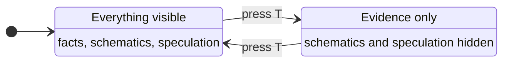

The long-form definitions, the claim-by-claim check and the list of independent reviews live in the [research explainer](https://github.com/Hunterdii/weight-space-programming-explained#evidence), so they are written once and never contradict each other.

<br>

<p align="center"></p>

## 🏆 Two Parts, one project

This repository is the **website**. The research companion holds everything about the **evidence**. They are meant to be read together and deliberately do not repeat each other.

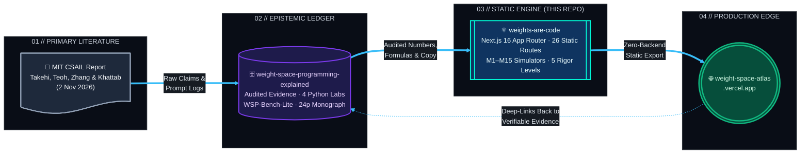

| | [`weight-space-programming-explained`](https://github.com/Hunterdii/weight-space-programming-explained) | **`weights-are-code`**  |
|:--|:--|:--|
| **Purpose** | The evidence: what was claimed, what holds up | The product: the interactive site |
| **You find** | Eight-experiment audit, Honesty Ledger, WSP-Bench-Lite, NumPy labs, 45-page whitepaper | Next.js app, 15 modules, content data, build scripts, whitepaper PDF |
| **Language** | Python, Markdown, LaTeX | TypeScript, React, Tailwind |
| **Read it if** | You want to check the science | You want to run, change or learn from the site |

<br>

<a id="contribute"></a>

## 🤝 Contribute

Fixes, translations, accessibility improvements and new modules are all welcome.

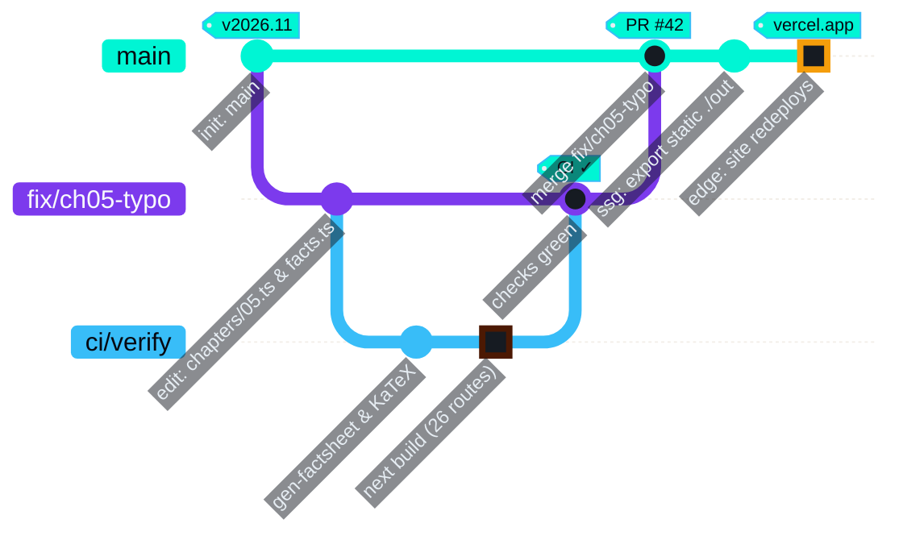

1. **Fork** and branch from `main`.
2. **Make the change.** Keep numbers, badges and wording consistent with the [research explainer](https://github.com/Hunterdii/weight-space-programming-explained).
3. **Run `npm run build`.** A clean static export is the bar for every PR.
4. **Open a pull request** that says what changed and why.

Found a wrong number? That is the most valuable kind of issue: [open one](https://github.com/Hunterdii/weight-space-programming-explained/issues/new). Fixing errors is a feature.

<!-- <p align="center">
  <a href="https://github.com/Hunterdii/weight-space-programming-explained/graphs/contributors">
    
  </a>
</p> -->

<!-- ## FAQ

<details>
<summary><b>Do I need to install anything to use the atlas?</b></summary>
<br>
No. Open <a href="https://weight-space-atlas.vercel.app/">weight-space-atlas.vercel.app</a> in any modern browser. You only need Node if you want to run the source code yourself.
</details>

<details>
<summary><b>Is this the official MIT CSAIL site?</b></summary>
<br>
No. It is an independent educational project. All discovery credit belongs to the MIT CSAIL authors, and nothing here is endorsed by MIT, CSAIL or any model vendor.
</details>

<details>
<summary><b>Why a static export and not a server?</b></summary>
<br>
The atlas has nothing to store or compute on the server. Pre-building every page makes it fast, cheap to host anywhere and hard to break. Visitor preferences stay in their own browser.
</details>

<details>
<summary><b>Where are the experiments and the evidence audit?</b></summary>
<br>
In the <a href="https://github.com/Hunterdii/weight-space-programming-explained">research explainer repo</a>, and on the atlas's <a href="https://weight-space-atlas.vercel.app/experiments/">experiments page</a>.
</details>

<details>
<summary><b>Can I reuse the code, text or visuals?</b></summary>
<br>
Yes. Code is MIT. Prose, diagrams and figures are CC BY 4.0, so reuse them with attribution.
</details>

<details>
<summary><b>Could this be misused?</b></summary>
<br>
Cheap, targeted weight edits could in principle strip guardrails or plant backdoors, and defenders could use the same tools to audit models. <a href="https://weight-space-atlas.vercel.app/read/11-the-severe-stuff/">Chapter 11</a> maps the risks and defences responsibly, without operational detail.
</details> -->


## ⚖️ Credits, licence and citation

- **Original research:** Rikiya Takehi, Jayden Teoh, Alex Zhang and Omar Khattab (MIT CSAIL).
- **Independent reviews** that shaped this project's caveats: Andreas Maier, Simon Willison, Matthew Honnibal and Sean Goedecke. Details are in the [research explainer](https://github.com/Hunterdii/weight-space-programming-explained#evidence).
- **Built by** [Het Patel (@Hunterdii)](https://github.com/Hunterdii), student.
- **Licence:** code under [MIT](https://opensource.org/license/mit); text, diagrams and figures under [CC BY 4.0](https://creativecommons.org/licenses/by/4.0/).

<br>

<!-- Cite the original discovery first, then this project if you used the site or its materials:

```bibtex
@misc{takehi2026weightspace,
  title        = {Sparks of Weight-Space Programming: {LLMs} can natively read \& write neural network weights},
  author       = {Takehi, Rikiya and Teoh, Jayden and Zhang, Alex and Khattab, Omar},
  year         = {2026},
  month        = nov,
  howpublished = {\url{https://rikiyat.github.io/blog/weight-space-programming/}}
}

@software{patel2026weightsarecode,
  title  = {Weights Are Code: the Weight-Space Atlas},
  author = {Patel, Het},
  year   = {2026},
  month  = nov,
  url    = {https://github.com/Hunterdii/weights-are-code},
  note   = {Live atlas: https://weight-space-atlas.vercel.app/}
}
```

<br> -->

<!-- <div align="center">

<a href="https://weight-space-atlas.vercel.app/lab/">
  <picture>
    <source media="(prefers-color-scheme: dark)" srcset="assets/readme/verbs-dark.svg">
    <source media="(prefers-color-scheme: light)" srcset="assets/readme/verbs-light.svg">
    
  </picture>
</a> -->

<div align="center">

<a href="https://weight-space-atlas.vercel.app/lab/">
  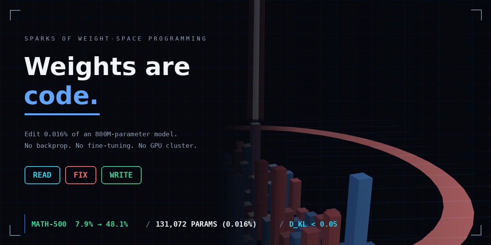
</a>


**Built with intellectual honesty, mathematical rigour and open science.**

**⭐ If this made weights feel less like a black box, a star helps others find it. ⭐**

<!-- <a href="https://star-history.com/#Hunterdii/weights-are-code&Date">
  <picture>
    <source media="(prefers-color-scheme: dark)" srcset="https://api.star-history.com/svg?repos=Hunterdii/weights-are-code&type=Date&theme=dark">
    <source media="(prefers-color-scheme: light)" srcset="https://api.star-history.com/svg?repos=Hunterdii/weights-are-code&type=Date">
    
  </picture>
</a> -->

<sub>Curated by <a href="https://github.com/Hunterdii"><b>Het Patel (@Hunterdii)</b></a> · <a href="https://www.linkedin.com/in/patel-hetkumar-sandipbhai-8b110525a/">LinkedIn</a> · <a href="https://github.com/sponsors/Hunterdii">Sponsor</a> · Live at <a href="https://weight-space-atlas.vercel.app/">weight-space-atlas.vercel.app</a></sub>

</div>
